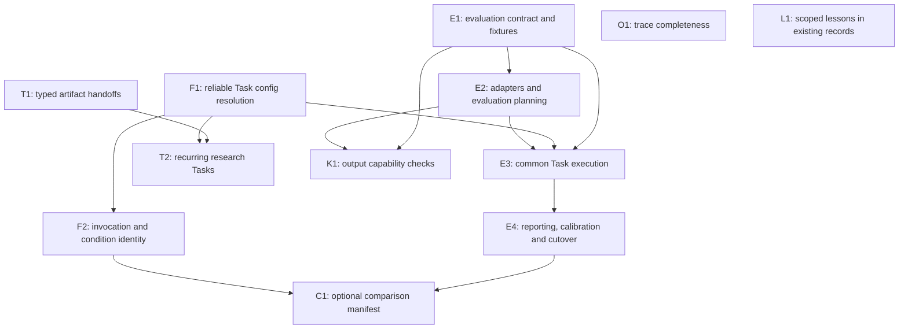

# Task-native evaluation and maintainable review exploration

2026-10-22. **Status: proposed; implementation has not started.** Checkboxes below describe
future work. Writing this plan does not establish that an abstraction is needed or that a
reviewing intervention works.

The subsequent [target architecture](../research/task-dataflow-refactor-design-2026-10-22.md)
provides the unifying design, systems evidence and an independent-review brief. Read it
before adopting this plan: the todo list remains a requirements inventory, and its ordering
and compatibility commitments are subject to that architectural review.

Start with a common, stable evaluation path for findings. Then make recurring research
operations ordinary APE Tasks with typed inputs and outputs. Adopt the remaining pieces
only where they solve a demonstrated problem. These changes should make a new reviewing
design easier to express and its results easier to trust, without making one particular
review workflow the architecture of the project.

This plan develops the [October 22 assessment](../research/codebase-experiment-design-audit-2026-10-22.md)
and **revises its implementation order**: evaluation comes first; a comparison abstraction
is optional and comes later. It builds on the [October 6 redesign and implementation record](../research/codebase-redesign-2026-10.md)
and the [typed-handoff plan](2026-09-21-typed-handoffs.md). It does not restart their completed
work. The code reading is of `develop` at `4695a1b1`, with newer reconstruction artifacts
on `review-reconstruction` at `eecb7d18` identified separately. No model calls are needed to
begin this work.

## 1. The intended shape of the codebase

Keep one execution system: APE Task data/config/result, scaffolds, workspace/runtime,
TaskOrchestrator, persisted outcomes, and the existing nested-execution contract. A
reviewer, a source collector, a sketch constructor, and a semantic judge can all use that
system while retaining different task contracts. A review design can compose these Tasks
or perform one whole-PR review directly.

Use three distinctions consistently:

1. **A Task is an operation.** It describes inputs, tools, legal outputs, and how completion
   is recognized. It can be run, retried, sampled, inspected, and reused across studies.
2. **A study is a composition and a question.** It selects operations, inputs, conditions,
   repetitions, and measurements. Its interpretation may remain ordinary study-owned
   Python and Markdown. There is no need for an `Experiment` superclass to do this.
3. **An evaluation instrument defines what a measurement means.** Its reference unit,
   candidate selection, context, rubric, aggregation, denominator, and output channel must
   be explicit. Running two matchers through the same scaffold does not make them the same
   instrument.

A deterministic export or join should normally remain a pure function with validated
artifacts. Use an APE Task for an operation that benefits from its execution lifecycle:
model interaction, tools, independent retries/samples, substantial scheduled work, or a
reusable completion contract. Do not put every small transformation through an agent
session to obtain reproducibility.

### Ownership

| Responsibility | Owner and starting point |
|---|---|
| Configuration resolution, task execution, sampling, outcomes, child execution | Generic APE: `src/ape/tasks/`, `src/ape/orchestration/`, existing scaffolds/runtime |
| Content references and invocation receipts | Reuse existing types first; extract mechanical parts into APE when another task family needs them |
| Mathlib references, pairing policies, judging rubrics, recall and assessment semantics | `src/mathlib_review/judge/`, `src/mathlib_review/schema/`, `src/mathlib_review/analysis/` |
| Registered Mathlib Task implementations | Existing `src/ape/tasks/lean_tasks/formal_math/` layout; thin adapters can call domain-owned protocol code |
| Review designs and submission contracts | Existing review task classes and `DESIGNS`; a design owns its legal output |
| Domain producers and evidence schemas | Existing `src/mathlib_review/producers/` and schema modules, extended only for actual consumers |
| A particular study's conditions, reading rule, amendments, conclusions | Its configuration and study record; reusable mechanics move into shared code |
| Optional expansion and validation of comparisons across runs | Initially a thin domain caller; generic condition expansion belongs in APE if extraction is justified |

APE should not import Mathlib gold obligations, decide what a maintainer wanted, or know
which study result would reopen a dead end. Conversely, a Mathlib study should not invent
its own worker, retry accounting, model client, or untyped success vocabulary.

## 2. Dependencies and adoption choices

An arrow means a hard prerequisite for the proposed implementation, not merely a useful
reading order. E1 and F1 can start immediately; E2 follows E1. The artifact and research-Task
work can be adopted separately even though evaluation is the recommended first priority.



| Item | Hard prerequisites | Independently useful result | Priority |
|---|---|---|---|
| E1 | None | Agreed evaluation meaning and migration cases | First |
| F1 | None | Task settings survive construction and reconstruction | Early framework fix |
| E2 | E1 | Validated, inspectable inputs and planned comparisons | First evaluation slice |
| E3 | E1, E2, F1 | One execution path for prospective judging | First evaluation slice |
| E4 | E3 | Common reports and an evidenced migration decision | Completes evaluation adoption |
| F2 | F1 | Conditions cannot silently change during resume/reuse | Before new cross-run comparability guarantees |
| T1 | None | Reusable, validated artifact handoffs | Next concrete study |
| T2 | T1, F1 | Recurring collectors/constructors/auditors run as Tasks | Incremental, operation by operation |
| O1 | None | Missing tool results stop looking successful | Small independent fix |
| K1 | E1, E2 | Output instructions, submission and evaluation agree structurally | Before changing output channels |
| C1 | E4, F2 | Declared comparisons validated against actual runs | Optional |
| L1 | None | Existing research records expose current qualifications | Can begin now |

F2 strengthens artifact caching in T1; it is not required to define a typed handoff. Until
the relevant identities are complete, T1 may reuse an explicitly supplied, verified artifact
but must not promise automatic semantic cache reuse. E2's evaluation adapters provide a
useful first example of artifact validation, and E3 supplies T2's preferred downstream
evaluator; neither is necessary to introduce a collector Task. T2 is needed by C1 only when
a comparison includes task-backed upstream stages. O1 supplies evidence for L1 but does
not block it.

Useful adoption packages:

- **Evaluation only:** E1 + F1 + E2 + E3 + E4. Stop with a common judging and reporting
  path; keep ordinary run configs and study scripts elsewhere.
- **Reusable research operations:** F1 + T1 + selected T2 operations, preferably after the
  evaluation package. Operations can be adopted sooner with their own artifact checks;
  claims about reviewer quality should use the adopted common evaluator. This does not
  require C1 or a general workflow graph.
- **Stronger comparison checks:** evaluation package + F2 + C1. This is useful even for
  whole-PR solo reviews with no intermediate research Tasks.
- **Immediate correctness improvements:** F1 and O1 can land separately while the
  evaluation contract is discussed. They need their own behavior-change records.
- **Research-memory improvements:** L1 is useful independently of the refactor.

## 3. E1 — Settle the evaluation contract before consolidating implementations

**Motivation.** The issue/resolution judge already has shared protocol code and an APE
Task. The newer probe matchers use different semantics. The first job is to decide which
differences are deliberate and give them stable names, rather than treating consolidation
as a transport migration.

### What already exists

| Instrument | Reference and candidate unit | Result and important policies |
|---|---|---|
| Current issue/resolution judge | One candidate or final finding against one eligible atomic gold obligation | `issue_match`, `resolution_match`, `abstain`; questions/defenses/no-change conclusions do not issue-match; matching locations are established before semantic judgment |
| Probe request matcher | A raw first-round maintainer ask against all findings from each anonymous reviewer, presented together | `reached`, `partial`, `no`, best finding index; only `reached` counts toward reach |
| Questions-enabled probe matcher | Same raw-ask unit | A sufficiently concrete author question can reach an ask |
| Reconstruction sketch matcher | Raw ask against a design proposal, with the reviewed diff | Can map counterpart declarations with different names; credits a recommended option; measures proposal content rather than a filed review request |

The current shared protocol is in
[`judge/protocol.py`](../../src/mathlib_review/judge/protocol.py), active version
`v4-semantic-v3-v9-rubric`. The registered Task is
[`LeanPRReviewV4JudgmentTask`](../../src/ape/tasks/lean_tasks/formal_math/review/judgment.py),
task type `lean_pr_review_v4_semantic_judgment`. Retain historical identifiers even when
their names mention older releases.

The probe rubric lives under
[`gpt52-postcutoff-2026-09-29`](../../results/pr_review_v5/probes/gpt52-postcutoff-2026-09-29/matcher_rubric.md);
its questions variant changes the allowed output interpretation. The reconstruction sketch
rubric is on `review-reconstruction` at `eecb7d18`, under
`results/pr_review_v5/probes/review-reconstruction-2026-10-19/sketch_matcher_rubric.md`.
Archive an adopted source into a durable shared location; a worktree path is not a stable
runtime dependency.

### Todos

- [ ] Inventory prospective callers and historical readers. For each, record reference
  unit, input channel, fields retained/dropped, scope, pairing/selection, context, rubric,
  judge settings, repetitions, aggregation, and reported denominator. Include
  `judge/runner.py`, `analysis/probes.py`, reconstruction readers, and imported labels.
- [ ] Declare the **default finding evaluator** for new request-only, atomic-obligation
  comparisons to be the existing issue/resolution protocol, subject to the E4 migration
  checks. Extend its callers before proposing a replacement rubric.
- [ ] Treat raw asks and atomic obligations as different reference types. Preserve
  one-to-many source links where one comment contains several asks. Atomizing an ask is
  annotation work with its own provenance; it is not a lossless format conversion.
- [ ] Give any retained raw-ask or proposal evaluator a named, versioned instrument.
  Avoid a free-form prompt field that permits every study to redefine matching under one
  metric name. A new instrument needs a documented distinction and calibration cases.
- [ ] Specify the question policy explicitly. Keep the current request-only evaluator
  stable. A question-aware evaluator has a different identity and its own examples; do
  not quietly change the meaning of `issue_match` to accommodate a new study.
- [ ] Separate the stable result envelope from instrument-specific labels. All instruments
  need source identities, planned-unit identity, recorded outcome, evidence locator,
  execution provenance, and completion status. They need not return identical booleans.
- [ ] Write metric definitions with their denominator and output channel: historical issue
  recall, resolution recall, raw-ask reach, proposal coverage, technical validity, and
  desirability. Unmatched findings are not automatically false positives; technical support
  is not desirability; PRs with no agreed ask are not certified negatives.
- [ ] Assemble a small, maintained set of saved examples with explicit expected behavior:
  same location/different concern; same concern/different fix; a satisfying alternative;
  concrete question; prerequisite versus requested change; multi-ask comment; cross-target
  fix; renamed counterpart in a sketch; valid finding absent from historical gold; missing
  code; malformed verdict; missing result. Include disagreements, not only easy matches.

Do **not** define `partial = issue_match` or `reached = resolution_match` as a migration
rule. Context, reference granularity, questions, and selection differ. Such correspondences
are empirical questions on aligned examples, and may remain invalid.

**Done when:** one short normative contract and the example set identify the default
evaluator, retained alternatives, metric meanings, and differences that forbid pooling.
This is a useful stopping point even before implementation. The contract can be revised
while proposed; adopted semantic changes receive new versions.

## 4. F1 — Make Task configuration reproducible through every execution path

**Motivation.** In [`create_task_from_data`](../../src/ape/tasks/base.py), configuration is
rebuilt from filtered overrides, without seeding from `config.task_config`. Unknown keys
are removed before strict validation can see them. The assessment reproduced a solo
`finding_budget=3` supplied through `task_config` becoming 20; a misspelled override also
became 20. The normal review YAML loader already translates its task configuration into
overrides, so this is not evidence that every ordinary YAML run lost its settings.

This is generic APE behavior. It matters to judges and future research Tasks just as much
as reviewers. See also the existing [framework-defects todo](../todo/framework-defects-2026-09.md).

### Todos

- [ ] Define and document one configuration precedence. Proposed order, low to high:
  task-class defaults; explicitly supplied config for that task type; record-level task
  overrides; explicit invocation overrides. Resolve ambiguous current callers before
  adopting this order. Reject a concrete config for an incompatible task type.
- [ ] Stop filtering unknown keys silently. For heterogeneous task batches, use explicit
  task-type targeting or an explicitly declared shared override; report unused keys.
  Do not broadcast a parent review config accidentally into its judge children.
- [ ] Resolve configuration through the same function for planning, direct construction,
  worker reconstruction, and nested execution. Persist enough resolved information to
  compare the task actually run with the task requested.
- [ ] Check the existing `TaskExecutionSpec`, `TaskOutcome`, and `ChildRun` contracts before
  adding fields. Completion, pause, failure, and a valid negative judgment are different
  outcomes. A parsed negative verdict is a successful judging operation.
- [ ] Add meaningful offline regression coverage: a non-default setting survives a worker
  and a child; a typo fails before execution; nested tasks retain their own settings;
  the existing YAML path renders the same intended baseline inputs.
- [ ] Record affected call sites and behavior changes. A historical run using defaults
  remains a historical default-config run; do not rewrite its receipt as if the intended
  setting had taken effect.

**Done when:** a dry-run receipt and reconstructed task agree about effective settings,
and an unused or misspelled setting cannot silently become a default. This fix can land
without E2, T1, or C1. It should be a framework-fix change separate from a review treatment.

## 5. E2 — Normalize inputs and plan evaluation with explicit coverage

**Depends on:** E1. **Starting code:**
[`judge/runner.py`](../../src/mathlib_review/judge/runner.py),
[`judge/semantic_judge.py`](../../src/mathlib_review/judge/semantic_judge.py),
[`schema/scoring.py`](../../src/mathlib_review/schema/scoring.py), and
[`schema/runs.py`](../../src/mathlib_review/schema/runs.py).

There are already useful contracts here: `EvaluationProtocol`, `PairManifest`,
`EvaluationReceipt`, sealed `SemanticPair`s, source hashes, and coverage reconciliation.
Extend or adapt these; do not introduce parallel manifests simply because the next study
uses raw asks.

### Todos

- [ ] Keep `candidate_from_finding` as the starting adapter for final serialized findings.
  Carry the finding ID, exact final text, source digest, anchors, and lineage back to raw
  candidates. A discarded pre-merge candidate cannot supply credit to the final finding.
- [ ] Add explicit adapters for raw asks, imported review outputs, and, only if retained,
  proposal decisions. Keep their native source artifacts. Report unavailable fields and
  lossy projections rather than manufacturing an atomic gold obligation or a review finding.
- [ ] Give findings stable source IDs before anonymous export. If historical imports have
  only list indices, bind indices to the exact ordered file hash. An index alone must not
  identify a finding after sorting or filtering.
- [ ] Make blinding and normalization declared transformations. Record label randomization,
  mapping seal, retained fields, target normalization, cue removal, truncation, and finding
  limits. The current first-20 Claude import policy is a historical policy to name, not a
  universal default to inherit.
- [ ] Create an inspectable evaluation plan before judging. It binds the reference set,
  selected final findings, input transformations, context, instrument, selection/pairing
  policy, sample plan, denominator, and expected evaluation units. Keep references hidden
  from generation tasks; evaluation artifacts are deliberately gold-bearing.
- [ ] Reuse anchor/relation/file pairing for the atomic-obligation path. Record the first
  applicable tier and justification as today. Widening eligibility changes a measurement;
  show it separately rather than silently repairing old scores.
- [ ] Distinguish pairwise judgment from setwise selection. A legacy matcher selecting the
  best finding from a collection has seen other findings. Executing pairwise prompts in a
  batch is not equivalent. Preserve this distinction in the instrument and planned units.
- [ ] Report both **reference coverage** and **execution coverage**. A reference can be in
  the denominator with no eligible candidate pairs: that is a selection/pairing miss under
  the declared policy. A planned judgment with no valid result is an execution gap.
  Empty candidate sets and zero-reference panels need explicit behavior, not division by
  zero or a successful-looking empty report.
- [ ] Validate imports against the sealed plan: reference IDs, finding IDs/indices, scope,
  labels, duplicates, and source hashes. A missing ask/reviewer cell cannot default to
  `no`, even though the old `unblind` helper treats missing cells as unreached.

The plan should be readable without executing the judge. For example, it should answer:
“These 25 raw asks, these final outputs, this question policy, these 66 expected sessions,
and this exact subset are being measured.” It should also reveal whether an unfinished
review session was omitted, included for forensic reading, or incorrectly counted as zero.

**Done when:** frozen examples produce deterministic plans and adapters; an edited source,
stale index, missing expected cell, or unannounced truncation is rejected. The existing
atomic-obligation path remains reproducible. No fresh semantic judgments are needed for
these checks.

## 6. E3 — Run canonical judgments as Tasks and share aggregation

**Depends on:** E1, E2, F1.

The current registered judge already shares rendering and parsing with the script judge.
Use it as the main path. The goal is to make the recurring matcher lifecycle use that
machinery, not to add another LLM client behind a generic evaluator interface.

### Todos

- [ ] Have evaluation planning produce ordinary Task records and execution configuration.
  The current request/atomic-obligation path should use
  `lean_pr_review_v4_semantic_judgment` with the existing protocol renderer.
- [ ] For retained raw-ask semantics, choose the smallest explicit implementation: a
  separate registered Task backed by a domain protocol, or a typed extension if its
  contract really is the same. Keep proposal comparison separate when it compares design
  decisions rather than submitted review requests. Do not force every result into
  `issue_match`/`resolution_match` fields merely to share execution.
- [ ] A setwise matcher Task is needed only if new studies retain setwise matching. Its
  input must contain the complete declared collection and anonymous presentation; its
  output must locate the supporting finding/decision and cover every expected unit.
  Historical setwise outputs can be imported without implementing a new model Task.
- [ ] Persist the full effective judge identity: existing rubric/model/context/sampling/
  decode/aggregation identity, plus the resolved scaffold/route and effective instructions
  where needed. Preserve per-input prompt/content hashes. Keep old cache identities readable;
  a newly complete identity must not claim old runs used settings they never recorded.
- [ ] Run through TaskOrchestrator or shared `run_subtasks` as appropriate. Reuse outcome
  and attempt readers. A hand-launched Claude session may remain an external label source,
  but its output enters through validation and known provenance, not a second scoring path.
- [ ] Factor deterministic aggregation so task aggregation and imported-label reporting
  cannot diverge. Preserve the current protocol's majority issue decision, resolution
  majority among issue-positive samples, requested/succeeded counts, abstention counts,
  and insufficient-success behavior. Specify tie and abstention handling in fixtures
  before changing any of it.
- [ ] Keep typed judgment payloads on typed results/artifacts. `custom_metrics` can carry
  numeric summaries; it should not be the only home for verdicts, explanations, source
  links, or coverage state. `success=True` means a valid judgment was recorded, including
  a valid negative; it does not mean a finding matched.
- [ ] Reconcile planned units and valid outputs before scoring. Missing, duplicate, stale,
  malformed, or out-of-scope results must yield an unscored/incomplete evaluation. Preserve
  valid partial outputs for diagnosis and resume.

**Done when:** the same sealed input and recorded sample verdicts produce the same aggregate
through direct Task execution and imported-label replay. Provider differences are measured
as differences in judges, not normalized away. A new probe can invoke the common evaluator
without copying a rubric file, creating its own model client, or inventing missing-result
defaults.

**Partial adoption:** route only prospective finding evaluation through this path first.
There is no requirement to recreate every historical sketch matcher or relabel every old
study before the default evaluator becomes useful.

## 7. E4 — Share reports, calibrate the migration, then switch callers

**Depends on:** E3. This item has an offline part and a separate user-run semantic
calibration part. A successful offline refactor does not by itself establish judge quality.

### Todos: offline reporting and compatibility

- [ ] Make deterministic report builders consume the validated evaluation artifacts.
  Reuse `semantic_report`, `report conditions`, and their denominator/identity checks.
  Keep raw-ask reach and issue/resolution recall distinctly named.
- [ ] Report per-reference outcomes and their supporting final finding IDs; then derive
  per-PR and per-session aggregates. Mean, union, and stable hits are distinct quantities.
  Union over repetitions is not the quality of a single deployed reviewer.
- [ ] Show failed/incomplete sessions and missing judgment coverage explicitly. Default
  headline comparisons should require the declared coverage; forensic partial reports
  must say what they exclude and cannot silently compare against complete runs.
- [ ] Keep emission volume, historical alignment, independent validity/desirability labels,
  and cost as distinct columns. Count repeated findings once per reference according to
  the declared aggregation; do not mistake finding volume for recall.
- [ ] Add replay fixtures from the current issue judge, a probe matcher, and reconstruction
  outputs. With recorded labels, transport/import/report refactors must preserve values
  exactly. A planned semantic change should instead show the affected examples explicitly.
- [ ] Put one compatibility table beside the reports: old instrument, new instrument,
  source panel, mapped reference units, changed policies, comparable metrics, and metrics
  that cannot be compared. Historical result files remain untouched.

### Todos: calibration and adoption

- [ ] Select a blinded, stratified calibration panel before running judges. Include
  near-negatives, cross-target cases, questions, ambiguous prerequisites, and unmatched
  findings from both controls and treatments. Use independent adjudication for disputed
  cases; another model's agreement alone does not define correctness.
- [ ] Separate two checks: **execution migration** under the same instrument and effective
  settings; **semantic comparison** between instruments. Exact byte/label/report parity
  is appropriate offline. Semantic agreement thresholds and sampling precision must be
  declared for this calibration, rather than copied automatically from the old 18-pair R0.
- [ ] Record repeated-judge variability and disagreements by category. The
  [R0 runbook](../research/r0-judge-equivalence-runbook.md) is useful history: decode-budget
  differences once moved verdicts despite shared rubric text. It is not a current universal
  gate, and `r0_equivalence.py` deliberately joins a retired cache/rubric.
- [ ] Prepare pinned configs, a dry-run plan, output locations, and complete manual commands
  for the selected calibration. API-backed semantic judging is user-run. No implementation
  step should silently trigger model calls as a test or import side effect.
- [ ] Adopt by caller: first default final-finding evaluation, then new raw-ask probes if
  retained, then other measurements as needed. A failed calibration blocks that semantic
  replacement; it need not block reusable import, coverage, or reporting improvements.
- [ ] Leave historical readers as thin compatibility adapters. Mark new hand-written
  matchers as requiring a named instrument and shared execution/import path. Extend the
  existing research-code lints narrowly when they can catch a concrete duplication.

**Done when:** one existing final-finding study and one raw-ask probe can use common
planning, validated execution/import, and reporting; their metric differences remain
visible. New prospective claims cite the adopted instrument. If semantic calibration is
pending, the status is “plumbing complete, evaluator adoption pending,” not “equivalent.”

## 8. F2 — Separate input identity, effective condition, and execution attempts

**Depends on:** F1. **Independent of:** T1/T2 and a general experiment abstraction.

**Motivation.** Current task input hashes do not capture every effective condition.
Prompt/context file bytes can change at the same path. The resumable plan allows the entire
`scaffold_config_sha256` to change, although that digest includes semantic settings as well
as operational ones. Other explicit fields still guard the model and several policies;
this is a gap in the remaining protected settings, not an absence of identity everywhere.

### Todos

- [ ] Write down the roles of existing IDs before adding more: Task data `global_index`,
  generation plan/receipt, run plan/revisions, stage records, evaluation protocol, and
  judge identity. Preserve the existing `knob()` behavior and frozen historical identities.
- [ ] Resolve a versioned invocation record containing input content references, effective
  task settings, instructions, design implementation identity, scaffold/tool interface,
  model/route/effort, tool grants/stores, and resource policy. Reuse `TaskExecutionSpec`
  and existing receipts; add the missing projection rather than replacing all IDs.
- [ ] Content-address external prompt/context/evidence inputs and retain snapshots or
  durable references. A git revision plus a dirty worktree path is insufficient. Record
  native tool/CLI versions when their behavior is part of the route.
- [ ] Keep execution attempts/revisions separate from the condition being studied. Retries,
  scheduling, and repaired infrastructure need lineage. Changes to caps/timeouts may be
  allowed operationally but remain visible to a fixed-resource comparison.
- [ ] Distinguish generation from evaluation identity. Changing a rubric should permit
  reevaluation of the same final findings without regenerating them. Gold-bearing inputs
  remain outside the reviewer's generation plan and workspace.
- [ ] Require complete relevant identity before automatic reuse. Old runs with unknown
  effective settings remain usable as qualified historical evidence; do not assign
  guessed values to make them appear comparable.

**Done when:** editing context bytes or effort changes the effective condition; unchanged
bytes at a relocated path remain identifiable; retry lineage is preserved; and a resource
amendment cannot silently become another repetition of the original condition.

## 9. T1 — Reuse artifact handoffs before designing a general pipeline

**Depends on:** no other implementation item. E2 is a useful first consumer of these
patterns. F2 is required before claiming automatic reuse across complete semantic
conditions; explicit verified inputs can be used sooner.

**Motivation.** We already have `ArtifactRef`, `StageInput`, `StageRecord`, run state, and
stage adapters. The reconstruction sequence has richer handoffs than a context title/text
pair: acquired sources, correspondence hypotheses, constructions, checks, and consumer
outputs. Its later amendments show why exact supplied evidence and construction
prerequisites matter.

### Todos

- [ ] Select one real chain from the saved reconstruction work as the consumer of this
  change. Inventory its actual files and validation requirements before defining types.
- [ ] Reuse `ArtifactRef` for location, digest, schema, and role. Add only missing common
  envelope fields: producing invocation/stage, parent references, availability/completion,
  and relevant access/cutoff restrictions. A content hash is not an authorization to expose
  gold to the reviewer.
- [ ] Define small domain payloads as needed: source snapshot with date/commit/location;
  proposed correspondence with endpoints and status; construction with exact code/patch,
  imports and prerequisites; check result with workspace and verification scope.
  Link existing `PatchSet` and verification types instead of introducing them again.
- [ ] Keep observed facts, inferred relations, and normative preference claims distinct.
  A frequent pattern is not automatically a convention the reviewer should enforce.
- [ ] Make packet sections and tools views over typed artifacts where their information is
  intended to be equal. If selection, wording, or interaction differs, retain the delivery
  variant as part of the treatment identity.
- [ ] Add a prepare/wait/import boundary for externally supplied labels or human assessment.
  Record expected units, source artifact, labeler provenance, and validation outcome. Waiting
  for labels is a study state, not a long-running model Task that fabricates success.
- [ ] Verify digests and schemas at consumption and record exact consumed references in the
  existing stage ledger. Reusing upstream work should not depend on guessing file names.

**Done when:** a saved source-to-consumer-to-evaluation chain can be reconstructed from
references, and an altered source or incomplete required artifact is rejected. It can be
run sequentially with ordinary Python calls and existing orchestration; no DAG engine is
needed to meet this criterion.

## 10. T2 — Promote recurring research operations into ordinary Tasks

**Depends on:** T1 and F1. Adopt one operation at a time. E3 supplies the preferred
downstream evaluator when available; it does not force every producer to emit findings.

### Candidate operations and contracts

| Operation | Typical input → output | Why use a Task; what stays outside |
|---|---|---|
| Source acquisition | Gold-free review episode, dated stores, acquisition policy → located source records and coverage | Tool-using search, independent limits/retries; deterministic packaging stays a function |
| Correspondence analysis | Source artifacts and reviewed state → relations with evidence and uncertainty | Model-assisted judgment with reusable typed output; not an assertion of normative authority |
| Alternative construction | Episode, selected evidence, workspace → exact alternatives, checks, prerequisites | Can fail or repair independently; does not earn finding credit until submitted by a reviewer |
| Evidence/technical audit | Exact artifact or construction and workspace → scoped validity/support judgment | Repeated model/tool assessment; distinct from desirability and historical-ask recovery |
| Reference annotation, if needed | Maintainer comments and source context → proposed atomic obligations and provenance | Gold-side annotation and review; separate from generation, never a silent adapter |
| Blinded choice diagnostic, if repeated | Fixed alternatives, checks and evaluation context → choices and stated reasons | Isolates selection/judgment from discovery; its success is not end-to-end reviewer recall |
| Final review consumption | Episode and optional evidence artifacts → design-owned output projected to final findings | Existing solo/design Tasks should be extended through their seams |
| Semantic matching | E2 evaluation unit and instrument → typed verdict | E3, rather than a newly scripted matcher |
| Off-gold desirability assessment | Blinded final finding plus assessment context → independent desirability label | Separate label contract; human input can use T1 import without an agent Task |

These are candidate boundaries, not a requirement to split all reviewing into these stages.
A strong solo reviewer remains a first-class design. A Task may search, construct and review
within one session when that is the intended condition.

### Todos

- [ ] Choose the first recurring operation from an upcoming study, not from this entire
  table. The best initial reuse is a producer/auditor already run repeatedly by scripts.
- [ ] Give it typed Task data, task-specific config and result, legal submission, validated
  completion, and artifact references. Use existing `BaseTask`/`BaseLeanTask` patterns;
  select Lean workspace support only when needed.
- [ ] Execute the same contract through each relevant supported scaffold. Check legal
  tools, output serialization, and actual consumed inputs. Multi-harness support means
  shared task meaning, not identical provider prompts or model behavior.
- [ ] Compose top-level Tasks using the existing orchestrator; use shared `run_subtasks`
  for genuine nested work. Chained execution should remain available for routes where
  holding a long child session inside a parent tool call is unsuitable.
- [ ] Reuse the existing graph-only `Producer.facts(graph)` adapter for its simple
  deterministic detectors. Add a task-backed artifact adapter where necessary instead of
  expanding that interface to impersonate every acquisition process.
- [ ] Keep study-specific contrast/readout code beside the study. Move a repeated export,
  anonymous-label import, or result join into shared code when a second caller appears.
- [ ] Account for all attempted work, failed prerequisites, producer compute, and reused
  producer artifacts. For a deployed pipeline, report the upstream cost required to obtain
  its inputs; show amortization assumptions separately.
- [ ] Demonstrate two compositions: evidence supplied to the existing reviewer, and a
  source-only or correspondence-only diagnostic with the same downstream evaluator.
  New behavior should live in its Task/design module and configuration, without a new
  condition-specific branch in `review/runner.py` or `analysis/probes.py`.

**Done when:** one actual operation is reusable in two compositions with shared execution,
artifact validation, and accounting. It can be adopted without converting all prior probes.
Evaluate another operation's needs before expanding the abstraction.

## 11. O1 — Make trace coverage and check scope explicit

**Depends on:** no other implementation item. Begin with the small correctness fix.

**Motivation.** A synthetic `lean_verify_edit` call with no recorded result is classified
as `answered` by the current [`tool_outcomes`](../../src/mathlib_review/analysis/tool_outcomes.py)
path. This does not establish that real runs contain the defect. Separately, reconstruction
amendment 7 includes decliners whose attempted constructions failed with missing imports
or prerequisites; those failures do not isolate a preference decision.

### Todos

- [ ] Distinguish a missing result from an empty valid result; report missing/unknown and
  transcript coverage explicitly. Check both scaffold transcript formats and interrupted
  attempts. Keep native transcripts available.
- [ ] Normalize observable events through existing execution/stage readers: tool call/result,
  artifact production/consumption, submission rejection, successful serialization, and
  evaluation. Correlate call, candidate, artifact, and check IDs where actually available.
- [ ] Attach checks to the exact attempted code, imports, workspace, prerequisites, and
  claimed verification scope. A failed attempt is a result about that attempt. A repair
  must not overwrite its history or retroactively warrant another patch.
- [ ] Keep post-hoc concern annotations optional and distinguish observed actions from
  inferred decisions. Use `unknown` when a trace does not reveal why a candidate vanished.
  Do not require a prose ledger and then count its presence as proof of investigation.

**Done when:** an interrupted call cannot count as answered, and an analyst can distinguish
“the intended alternative was checked and rejected” from “this construction failed before
testing the intended alternative.” The first fix can land without the later event work.

## 12. K1 — Check output capabilities across design, submission, and evaluation

**Depends on:** E1, E2. Task-native producer conversion is not a prerequisite.

**Motivation.** The Phase A consumer brief prohibited questions while parts of the study
design and evaluation contemplated them. We also have historical coordinated-emission
lessons: a schema existing somewhere is insufficient evidence that the model can use it.
`PatchSet` and Responses phase preservation already exist; they are not new features to
reimplement under this plan.

### Todos

- [ ] Let each design declare a small set of supported output capabilities: concrete
  requests, author questions, coordinated changes, and verification claims where relevant.
  Keep the actual submission schema with the design.
- [ ] Validate selected capabilities against rendered instructions, available submission
  tools, serialization, the final-finding adapter, and the selected evaluator. Test actual
  scaffold interfaces, not only APE tool-registration tables.
- [ ] Make question-aware studies select an aligned contract and instrument. Mechanical
  checks should reject structural mismatches; retain review of prose instructions because
  a capability bit cannot prove that the prompt permits an action.
- [ ] Add route fixtures for known search hits, including symlinked trees and supported
  paths, tool response continuity, and final submission. The recent built-in Claude search
  defect would not be caught by testing only APE's search implementation.
- [ ] Keep local fixture checks separate from user-run live route pilots. Authentication,
  model revision, and provider continuity cannot be established by an offline tool mock.

**Done when:** a selected question or coordinated-change channel survives an example from
instructions to final serialized output and evaluation, and an incompatible combination
fails before the study runs. This is a small compatibility description, not a registry of
every possible contract-knob combination.

## 13. C1 — Consider a comparison manifest only after runs are trustworthy

**Depends on:** E4, F2. T2 is required only for comparisons using task-backed upstream
stages. **Optional:** a study can use ordinary configs and common reports without C1.

### What “experiment” could mean concretely

There are two useful operations to automate:

1. Expand declared conditions and repetitions into normal task/run configurations, with
   shared input references and named intended differences.
2. Compare actual receipts against those declarations before aggregating results.

Neither operation needs a second executor, a base class inherited by research projects,
or a central registry for every hypothesis. The scientific hypothesis, decision rule,
exposure history, and interpretation can remain a linked study record. Deterministic
condition expansion and receipt comparison are generic; Mathlib's gold scope, pairing,
metrics, and leakage policies remain domain-owned.

### Todos

- [ ] First implement a small comparison-manifest consumer beside the existing condition
  report. It should reference normal configs/receipts, rather than contain their duplicate
  implementation. Use a typed schema with strict keys.
- [ ] Include only demonstrated requirements: study ID/record, named conditions,
  repetitions, input panel, intended varying factors, fixed factors, evaluator/metric
  identities, expected coverage, resource policy, and named reporting subsets.
- [ ] Allow declared multi-factor changes. “Model plus route” is a legitimate configuration
  comparison when named as such. Do not force one-field treatments or label a model-and-
  route contrast as a model-only effect.
- [ ] Show resolved condition differences before execution and verify effective receipts
  after it. A pair of differently configured runs must not become repetitions merely
  because the caller places their names under one label in `report conditions`.
- [ ] Bind producer artifacts and their acquisition cost. Label oracle/retrospective inputs,
  autonomous acquisition, and reused evidence distinctly. An expensive model's supplied
  sketch requires an appropriate ordinary-extra-work comparator before an efficiency claim.
- [ ] Track development exposure and fresh panels in the study metadata. Report dev/val/
  post-cutoff subsets separately. Use PR or campaign groups for inference when asks share
  causes; do not treat each related ask as an independent replication.
- [ ] Exercise the checker on completed runs: one verified repetition group, one mismatched
  group, one declared multi-factor contrast, and an incomplete legacy identity. The last
  should be “cannot verify,” not an automatic pass or forced deletion of useful history.
- [ ] Before extracting into APE, use it for a second structurally different task family
  or study. Extract only task-agnostic expansion and receipt-diff logic that both use.
  If the second use does not exist, keep a thin domain utility or plain manifest.

Illustrative shape, **not an implemented configuration/API**:

```yaml
study_record: docs/research/<study>.md
panel: <versioned-panel-ref>
conditions:
  control: <normal-run-config>
  supplied_sources: <normal-run-config>
repetitions: 3
allowed_differences: [review.context_artifacts]
evaluation: <sealed-evaluation-protocol-ref>
reporting_subsets: [development, fresh]
```

For the current Luna/Sonnet baselines, use separate baseline/treatment blocks within each
model/route configuration. Their different routes are already acknowledged in the
[cheap-baselines plan](../research/review-reconstruction-cheap-baselines-2026-10-20.md).
The manifest should preserve that qualification, not hide it behind an experiment name.

**Done when:** the checker names an undeclared effective difference and verifies a valid
comparison using existing run/evaluation receipts. If handwritten configs plus the checker
are sufficient, stop there. A general `Experiment` class remains unnecessary.

## 14. L1 — Make lessons discoverable, bounded, and connected to the next decision

**Depends on:** no implementation item. Use E1's metric distinctions as they settle.

There is already a substantial record in `questions.md`, `dead-ends.md`, todos, protocols,
and research documents. Add a small structured index to those records rather than another
parallel narrative store.

### Todos

- [ ] Pilot metadata on a few claims that already acquired important qualifications:
  reconstruction evidence delivery versus construction versus judgment; filing-bar
  changes; convention guidance; agreement-based selection. Link the current amendment,
  original result, and exact code/artifact versions.
- [ ] For each claim record its population/condition, measured outcome, evidence,
  limitations, status, superseded-by link, reopening condition, and next discriminating
  observation. Distinguish an infrastructure fix, intermediate capability, and reviewer
  improvement. A negative small-panel result is not a universal impossibility result.
- [ ] Include literature claims with their mechanism and transfer assumptions. For example,
  trained rule checking and deployment feedback in AutoCommenter/BitsAI-CR are not the
  same intervention as adding a prompted taxonomy here. Preserve links to the existing
  [systems survey](../research/code-review-systems-survey-2026-09.md) rather than rewriting
  it as a catalog of endorsements.
- [ ] Close a study by recording the intended contrast, the contrast actually executed,
  what was learned, unresolved explanations, and the resulting next test/design constraint.
  Link protocol/tool defects to affected claims for reassessment, without automatically
  declaring the scientific conclusion reversed.
- [ ] Generate a current mechanism table only once the metadata is useful on these examples.
  Until then, a hand-maintained index with stable links is enough.
- [ ] Turn deterministic lessons into validation or regression checks where appropriate.
  Keep empirical conclusions as scoped evidence; do not encode “this direction once
  failed” as a test that forever forbids it.

**Done when:** a new session following the existing indexes finds both a result and its
latest qualification. For amendment 7, it should see that construction/prerequisite
failures still complicate the preference interpretation. This can be useful before any
architecture change is adopted.

## 15. First implementation tranche and review checkpoints

The first tranche should be small enough to review without approving the rest of the plan:

1. **E1:** write the evaluation contract, migration inventory, and saved edge-case fixtures.
   Decide the default finding metric and name the genuinely different instruments.
2. **F1:** fix configuration resolution, with offline worker/child reconstruction checks and
   a record of behavior-changing call sites. This can proceed alongside E2.
3. **E2:** implement final-finding/raw-ask adapters, explicit transformations, sealed plans,
   and coverage validation. Use existing artifacts; make no new semantic judgments.
4. **E3:** route the default evaluator through the existing registered Task and shared
   aggregation. Retain validated legacy label import. Add a raw-ask Task only if a new
   caller needs to run that distinct instrument.
5. **E4 offline:** demonstrate exact report replay on saved outputs. Prepare the bounded,
   user-run calibration and document what remains unestablished.
6. **E4 adoption:** after calibration, switch prospective callers individually. Record the
   instrument and migration decision. Stop here if evaluation is the only adopted package.

O1's missing-result fix is a suitable independent small change. F2, T1/T2, K1, C1, and
L1 can each be adopted in their stated scope without approving a comprehensive redesign.

### Decisions to revisit at concrete checkpoints

| Checkpoint | Decide with evidence | Default if evidence is absent |
|---|---|---|
| After E1 | Does the next study need raw-ask or question-aware semantics? | Keep request-only issue/resolution as the stable atomic-obligation default; retain old raw labels for history |
| After E2 | Is atomization appropriate for the intended raw asks? | Preserve raw references and their own metric; do not claim lossless conversion |
| After E3 | Do new studies need setwise matching? | Import old labels; do not build a collection Task just for symmetry |
| After E4 | Are old and new instruments comparable on the aligned panel? | Report separate series and their differences |
| After first T2 operation | Does another operation need the same handoff/composition seam? | Keep a small study-owned composition |
| After C1's second use | Is there generic condition-expansion logic worth moving to APE? | Keep the utility local; no experiment framework |

Revise proposed items freely before adoption. Once an item lands, record its commit,
acceptance evidence, and any remaining limitation. Preserve the adopted contract/version;
make later semantic changes through an explicit amendment or successor plan so historical
measurements remain interpretable. `docs/plans/STATUS.md` covers older plans and need not
be repurposed as this plan's implementation ledger.

## 16. Validation and boundaries

For implementation, use focused offline checks tied to the actual behavior changes.
Existing starting points include:

- `tests/datasets/test_pr_review_v4_judge_task.py`
- `tests/datasets/test_pr_review_v4_semantic_pairing.py`
- `tests/datasets/test_pr_review_v4_judge_source_run.py`
- `tests/datasets/test_pr_review_v5_judge_denominator_scope.py`
- `tests/datasets/test_config_strictness.py`
- `tests/ape/test_task_identity_knobs.py`
- `tests/ape/test_task_result_contract.py`
- `tests/mathlib_review/test_stage_ledger.py`
- `tests/mathlib_review/test_tool_outcomes.py`

Add fixtures for semantics, source drift, missing coverage, configuration reconstruction,
and cross-scaffold serialization where those changes land. Do not add tests that merely
pin a new class name or mirror a pure helper's implementation. Run broader required checks
after relevant implementation changes. The 147 tests reported in the assessment checked
the previous tree; they do not certify this proposed work.

Fresh generation, ingestion, and semantic judging remain user-run. Offline replay can
establish identity, parsing, coverage, and deterministic report parity. It cannot establish
model capability, judge accuracy, causal reviewer improvement, or maintainer desirability.

Defer large runner rewrites, mandatory discovery/decomposition, a universal PR object,
replacement orchestration, a free-form parameter bag, and a registry for every study
component. Reuse the working seams first. The practical architecture check is whether the
next real change to evidence delivery, review composition, or output contract can live in
its own component and configuration while execution and evaluation stay shared.
