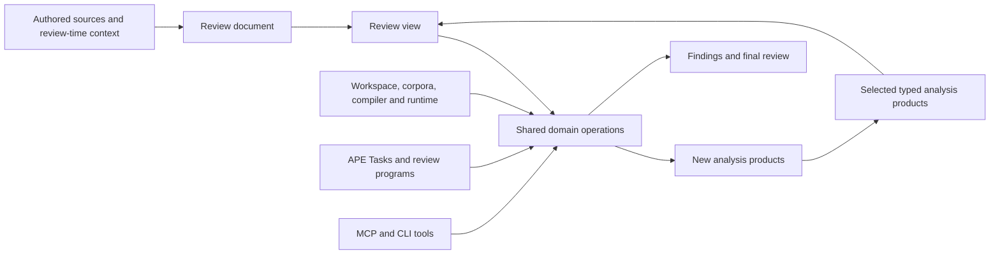

# Follow-up design: a review document, analysis products, and portable operations

2026-10-22. **Conditional architecture option for after the current refactor.** The concrete
design below specifies how a review document could work; the evidence does not yet justify
adopting the full representation. Section 0 states the research case and the tests needed
to decide its scope. This does not amend the implementation underway. Names and signatures
below are proposed interfaces, not APIs already implemented.

The [task/dataflow design](task-dataflow-refactor-design-2026-10-22.md) establishes typed
operations, outputs, and an understandable execution account. This proposal gives the
reviewing domain a common representation and explains how research programs and tools use
it. Code anchors refer to `develop@4695a1b1`; the implementation worktree is moving separately.
No new model experiments were run for this design.

## 0. Why would this improve reviewing?

The previous version established a coherent representation and useful software boundaries.
That is insufficient motivation for a significant reviewing redesign. The common Task/output
path and portable operations address demonstrated maintenance problems. A richer reviewing
AST needs an additional argument: which information or decision operation does it enable,
and which observed reviewing failure should change as a result?

### 0.1 A mental model of inconsistent recovery

A useful request requires more than encountering its source location. The reviewer must
form the relevant question, find or construct a meaningful alternative, compare it under
the right requirements, and communicate a justified conclusion. These events depend on
one another. An early plausible interpretation can direct later searches toward confirming
it; another run may discover a different comparison and follow a different path.

For a given concern, success can be decomposed into conditional probabilities of selecting
the relevant investigation, obtaining the needed evidence/alternative, making a sound
comparison, and retaining the resulting finding. This is a diagnostic decomposition, not
an assumption that the events are independent or that all historical asks are desirable.

A representation can affect those transitions only through what a program actually does
with it: preserving context that was lost, querying a relationship, exposing an alternative,
executing a missing check, or revisiting a conclusion in light of new evidence. Merely
serializing a declaration and its comments differently need not affect any transition.

An inconsistently recovered ask establishes that some tested reviewers can reach it in
some conditions. It does not identify why others fail, prove that averaging more reviews
will be useful, or establish that the model reliably possesses every required capability.
Evaluator disagreement also contributes to observed variation. Two repetitions cannot
estimate an ask's recovery probability precisely.

### 0.2 Concrete cases and predictions

The same-configuration Opus audits were reread locally: both have the same judge identity
and 23 obligation IDs, each hits seven, their intersection is six, and their union is eight.
The [consistency reading](../../results/pr_review_v5/probes/claude-models-2026-10-01/README.md)
identifies the changing issues as the set-comprehension concern on 33321 and Parseval reuse
on 33149. This is useful evidence of variation, not a population estimate or an isolated
measurement of model randomness.

| Case and observed failure | Potential mechanism | Prediction and limit |
|---|---|---|
| PR 33321: a documented decomposition incident separated a doc-comment from its declaration; the existing `attached_to` field records why that relationship was added | Preserve the actual comment/declaration context through selection and rendering | Shared subject structure should prevent that information loss. Restoring the same raw context is the appropriate control; this does not establish a benefit from a richer AST. |
| PR 33149: one same-config run found the existing Parseval result by search and the other did not | Retrieval of an alternative by mathematical role, with its source available to comparison | Correct existing-API evidence should help a reviewer that can recognize reuse once the API is supplied. A source tree alone should have little effect; systematic discovery remains a separate capability to test. |
| PR 33321: same-config runs raised different concerns at `baseOf`, including the set-comprehension issue | Choosing an investigation/alternative at a visited subject | Recording a visit or annotating `no_issue` should not fix it. A useful intervention must elicit and evaluate the predicate-versus-set representation question without supplying the historical ask. |
| PR 43167: reviewers considered naming but chose different governing analogues; an earlier packet did not offer the requested suffix swap | Identify the relevant mathematical role and compare competing naming conventions | Generic analogue retrieval should continue to be unreliable. A useful comparison must distinguish argument position from the role encoded by the suffix, and handle contrary analogues. Having named nodes is insufficient. |
| PR 33117: fixed-search controls did not encounter `to_fun`; assisted sessions considered it, but often declined; later checking confirmed an API tradeoff | Discovery, valid construction, explicit interface checks, and conditional preference are separate operations | Better comparison should reduce unsupported rejection from missing prerequisites and expose real client/API costs. It should not automatically increase full historical-ask compliance. This is a test of justified choice, not compulsory mechanism adoption. |
| PR 33066: a sketch avoided a redundant constructor, while a consumer recommended more use of the submitted constructor | Transfer the specific equivalence/redundancy comparison, rather than only an alternative design | Supplying the constructor correspondence should improve diagnosis if judgment is the remaining bottleneck. Merely retaining the sketch or adding structural nodes should not be expected to do so. |

Evidence: the [source-schema explanation](../../src/mathlib_review/schema/identity.py),
[initial reconstruction assessment](review-reconstruction-results-review-2026-10-19.md),
[Phase A assessment](review-reconstruction-phase-a-review-2026-10-20.md), and
[search-fix assessment](review-reconstruction-cheap-baselines-2026-10-20.md).
These are distinct studies; effects and counts must not be pooled.

For 33117 specifically, the saved amendment-7 labels are 0/3 unassisted, 0/3 with the
correspondence section, and 1/3 with additional adoption evidence. The positive survives
final serialization with diagnostic admission, not publication. Missing-import constructions
do not refute the alternative. Conversely, the local audit confirms that generated sum/prod
interfaces can break the short client call used with handwritten declarations. The
[saved diagnostic](../../results/pr_review_v5/probes/review-reconstruction-search-audit-2026-10-21/README.md)
supports that technical distinction. None of these facts establishes a reliable treatment
effect or that the full historical recommendation is the best reviewing outcome.

The negative evidence matters: per-concern structured ledgers and critics did not improve
the recorded GPT-5.2 dev recall; independent reconstruction supplied transferable proposals
without the registered historical-ask gain. More annotations, explicit stages, or stored
alternatives have already proved insufficient in related forms. A new implementation
cannot treat those forms as an untested cure.

### 0.3 The smallest research object worth trying

The strongest candidate is a **comparison between alternatives under explicit obligations**:
the unresolved decision, relevant alternatives, their supporting sources, what must remain
true, checks actually performed, remaining tradeoffs, and a justified or unresolved conclusion.
This can be a small typed Task output over existing source references. It need not begin
with a document-wide tree, a required per-node ledger, or a mandatory analysis on every PR.

For 33117, obligations include proposition generation, client-call compatibility, automation
registration, and import exposure. For naming, they include the mathematical role represented
by a suffix and which analogue shares that role. The product records comparisons; it does
not discover the correct alternatives or settle preference by existing as a type.

### 0.4 Tests before broad adoption

1. **Diagnose natural success/miss pairs using saved runs.** Include stable recoveries,
   inconsistent recoveries, and persistent misses. Locate the first substantive divergence:
   query, retrieved source, alternative, construction, judgment, finalization, or evaluation.
   Use observable actions and outputs; a stated rationale alone is not a causal account.
2. **Test component sufficiency with explicit limits.** Supplying the evidence or intermediate
   comparison from a successful run can test whether a fresh reviewer can use it. An
   ask-informed or success-selected product is a diagnostic intervention, not evidence that
   an autonomous producer can obtain it. Hold that artifact fixed across fresh consumers.
3. **Separate representation from procedure.** Compare a structured product with an ordinary
   rendering containing the same substantive evidence, relations, and questions. Compare
   explicit alternative-comparison work with an ordinary additional review under comparable
   resource bounds. If the procedure helps equally in plain text, retain the operation and
   avoid requiring a richer AST to obtain its benefit.
4. **Test autonomous production on fresh PRs.** Select investigations from reviewer-visible
   material without historical-ask cues. Evaluate final findings, losses of existing coverage,
   unwanted suggestions, cost, and the specific intermediate transition the intervention was
   meant to improve. Technical correctness and historical-ask recall remain separate from
   independent assessment of usefulness. Development cases supply predictions, not a final
   generalization claim.

These are proposed user-run model experiments, not runs authorized or performed by this
document. Existing APE Tasks, outputs, and plain source references can support the initial
tests. A universal review AST is not a prerequisite.

Adopt more of the representation only when a useful operation repeatedly requires shared
structural queries or relations that existing references cannot express clearly, or when
its adoption demonstrably removes maintained implementations. If representation changes
leave the relevant decisions unchanged and add maintenance burden, keep the simpler data
model. The rest of this document specifies a possible end state, conditional on that case.

## 1. The unifying design

**A reviewer is a program that builds and interprets analyses of a review document.**
The document represents the contribution and its context for reviewing. Analysis products
express what operations observed, inferred, tested, or proposed about it. Programs select
which operations to perform and which products to use. Tools expose those same operations
interactively; Tasks give substantial operations the existing execution lifecycle.

This is a compiler-inspired architecture organized around reviewing. Its AST is designed
for reviewing: comments, documentation, source changes, descriptions, and relationships
matter alongside declarations and proofs. A Lean compiler representation is one possible
input to an analysis. Its choices about what to preserve do not determine our representation.

The core vocabulary is small:

| Concept | Meaning | What owns it |
|---|---|---|
| Review document | The authored material and source structure being reviewed, with references to contextual sources | Domain data |
| Analysis product | A typed observation, hypothesis, check, proposal, or finding over explicit subjects | Domain data |
| Operation | A computation with typed inputs, outputs, and explicit resource dependencies | Domain implementation; ordinary functions or Task-backed work |
| Review program | The algorithm choosing operations, samples, supplied context, and final output | Ordinary Python plus existing APE execution |
| Tool binding | An agent-facing interface to an operation | Thin MCP/CLI adapters |

A `ReviewView` is a derived view of a document plus explicitly selected analysis products.
It supplies convenient queries and rendering; it is not a new authoritative execution
state. Existing invocation, sample, attempt, and outcome records describe how products
were obtained. Existing artifact references identify saved data.

This is a reviewing specialization of APE, not a new base class for every Task's data.
Convention induction over a dated corpus can produce a reusable hypothesis collection
before any particular PR is reviewed. That collection can then enrich many review views.
Reference feedback and evaluation-only material remain in separate evaluator inputs;
representing comments does not make hidden feedback eligible for a reviewer-facing view.



This lets a solo reviewer, a pass-oriented reviewer, and an interactive external agent use
one domain model and implementation library. Their control policies can differ. The
architectural commitment is shared meaning and operations, not a fixed review algorithm.

## 2. The reviewing AST: a document model built for its consumers

### 2.1 Authored structure and source preservation

The review document retains exact source text and indexes it with a tree useful for
reviewing. It can look conceptually like this:

```text
ReviewDocument
  contribution: title, description, author-supplied rationale available at review time
  base revision
    files and source trees, materialized or referenced
  submitted revision
    file
      module documentation
      imports
      namespace or section
        ordinary comment
        documentation comment
        declaration
          attributes, signature, body or proof regions
          nested source comments
        uninterpreted source region
  change mapping: source ranges and established before/after correspondences
  contextual source references: related code, dated discussions, earlier decisions
```

This is a source-oriented ownership tree with additional relations. Documentation may
belong to a declaration while remaining addressable in its own right. An ordinary comment
may stand alone, explain a block, or contain a hypothesis about design intent. Its text is
preserved even when attachment or interpretation is uncertain. Module documentation,
examples, and PR prose are reviewable material rather than disposable parser trivia.

Exact source bytes are authoritative. Structural nodes provide spans into them; unclassified
regions remain accessible. We need not tokenize every byte into an object to retain it.
An optional compiler analysis can add elaborated names, types, dependencies, or goals as
analysis data without replacing the source document or discarding comments.

Source structure should distinguish observed boundaries from uncertain associations. A
scanner-derived attachment is not automatically an established design dependency. When the
builder cannot classify a region, it records that limit and preserves the text. A parse
failure must not remove that region from the reviewer's accessible input.

### 2.2 Subjects and relationships

Every reviewable source object has a reference scoped to its document and source version.
A reference identifies an object, not the current absolute workspace path or a display
name that another revision can silently reuse. The implementation can reuse existing
entity/range IDs and artifact references; these names do not require new identity machinery.

An analysis subject can be one node, a collection of nodes, a whole contribution, or a
proposed semantic object. Examples include a declaration family, a naming choice, a comment
and its implementation, or an interface that ought to exist. A proposed missing abstraction
can be anchored to the contribution or related existing nodes; it need not masquerade as a
source declaration. Synthesis can create a typed proposal with its own identity.

Containment is a tree. Relations such as `documents`, `uses`, `corresponds_to`, and
`alternative_to` connect objects across it. Some are established by source/compiler data;
others are outputs of a model or heuristic and carry that provenance. Avoid inferring
semantic identity merely because two declarations have similar names or nearby spans.

Before/after nodes remain distinct. Alignment is an explicit relation, with uncertainty
where necessary, rather than an assumption that one node has a mutable history. Renaming,
splitting, or replacing a declaration does not demand artificial one-to-one alignment.

A review document does not eagerly copy the whole library or every historical discussion.
It can reference snapshot-scoped context and materialize the parts requested by analyses.
The source, revision, retrieval scope, and availability of those parts remain explicit.

### 2.3 The actual starting point

The existing `ChangeGraph`, `SemanticEntity`, `ChangeTarget`, source spans, and coverage
records in [identity.py](../../src/mathlib_review/schema/identity.py) cover part of this
model. The [builder](../../src/mathlib_review/release/change_graph.py) already recognizes
separate declaration, documentation, attribute, and structural targets. The
[declaration scanner](../../src/ape/toolkits/code/lean/lean_parser.py) is one extraction input.

Evolve or project these into the source model needed by consumers. Existing schemas are a
starting point, not a requirement to preserve their current boundaries. Replace redundant
representations on the adopted path, retaining readers for required historical artifacts.

## 3. Analysis products: typed annotations with independent meaning

An analysis product is data another operation can consume. It can annotate one subject,
relate several subjects, or propose a new object. Its content has a concrete domain type:

| Product | Example statement |
|---|---|
| Usage observation | These dated consumers use this interface, within this searched population |
| Documentation assessment | This comment promises behavior that this implementation does not provide |
| Convention hypothesis | This family appears to prefer one formulation under these conditions |
| Applicability assessment | These sites are eligible, these are excluded, and these remain unresolved |
| Technical check | This exact alternative compiled, failed, or timed out in this environment |
| Runtime observation | This test or profile produced this output for these inputs |
| Design proposal | This alternative interface or coordinated patch would address the identified goal |
| Finding collection | These requests, questions, or concerns are the reviewer's selected output |

The types define what the statements mean. A common attachment mechanism supplies subjects
and supporting references; it does not replace their payloads with `kind + arbitrary dict`.
Producer occurrence and input/output bindings come from existing execution records and
production links. Repeating their entire metadata inside every annotation is unnecessary.
A product can be a collection when its members need their own references.

The essential data contracts are roughly:

```text
ReviewDocument:
    episode, source references, structural nodes, change mapping

SubjectRef:
    document/source/corpus scope, node or semantic-object identity

Annotation[T]:
    one or more subjects, typed value T, supporting source/product references

ReviewView:
    document reference, explicitly selected product references
```

`Annotation[T]` illustrates the small common attachment mechanism. Existing concrete
products can supply these fields directly; a second wrapper around every output is not
required. A `ConventionHypothesis` still declares its applicability, alternatives,
exceptions, and support; a `TechnicalCheck` still declares its exact proposal, environment,
and observed outcome. Tasks can also return products such as an evidence collection
without forcing them into a node-by-node annotation interface.

Conceptually, a view supports ordinary typed access:

```python
view.source(comment_ref)
view.related(declaration_ref, relation="documents")
view.products(UsageObservation, subject=family_ref)
view.products(ConventionHypothesis, subject=family_ref)
```

These are proposed convenience methods over typed records and references, not a query
language or graph database. Rendering a view into model context is a separate, shared
operation; it records what selection and clipping delivered to the agent.

Two analyses may disagree. Two stochastic samples may produce different hypotheses.
Both products remain available; selecting one or combining them is an explicit program
choice. There is no global `current_truth` field on a node and no implicit latest-result
wins policy. A reusable saved view names its selected products, so it can be inspected later.

A comment's contents are source evidence about what the author wrote. An interpretation of
that comment is a separate claim. Likewise, compilation, observed adoption, and an inference
of desirability remain distinct. The architecture does not make a hypothesis true by
attaching it to a node or by giving it a typed schema.

A layer is simply a selected collection of analysis products. It does not introduce a new
storage system, annotation lifecycle, or aggregate success score. Not every low-level tool
response must be promoted to a separate artifact. Preserve reusable outputs and actual
observations at the boundaries already provided by Task/tool persistence.

## 4. Passes and execution

A pass is an operation or program consuming a document/view and producing analysis data.
It need not visit every node, preserve the same subject set, or be deterministic. Local
visitors, whole-PR analyses, grouped analyses, and interactive investigations all fit.

Use three implementation forms:

- A cheap deterministic operation is an ordinary typed function.
- A substantial, sampled, model-based, or recoverable operation uses an existing APE Task.
- A program composes those functions and Tasks, including conditional branches and loops.

There is no separate `ReviewPass` executor. A small traversal helper is useful where it
removes repeated walking logic. Scheduling, attempts, samples, and usage stay in APE.
Inputs name the selected document and products; outputs use the shared domain contracts.
Task-specific completion rules validate a legal result, independently of its research score.

### Dynamic checks are ordinary analyses

A runtime or compilation pass can materialize a proposed alternative in an isolated
workspace, run a check, and produce a typed observation. Its input identifies the exact
proposal, prerequisites, source version, environment, and check configuration. Its output
identifies what actually ran and what happened.

The authored document stays available. A proposed patch and its materialized source view
are separate objects linked to the original. Observations about a proposed version cannot
silently become facts about the submitted version. A failed import, a failed construction,
a timeout, and a negative test outcome answer different questions.

This accommodates compilation, generated usage examples, property tests, profiling, and
other dynamic analyses without building their execution into the node classes. Nodes own
data meaning; operations own behavior; resources own external effects.

### Dependencies and reuse

A product records the actual source/product inputs used by its operation through existing
bindings. Supplying a different comment, evidence collection, or proposal creates a different
request. Consumers may intentionally reuse unchanged upstream products or rerun an operation
for another sample. A source edit can invalidate an analysis of that source without forcing
all unrelated evidence to be regenerated.

Initially use explicit program dependencies and references. The design does not require
an automatic incremental-build engine or perfect dependency discovery for arbitrary code.
Dynamic reads remain recorded observations. If an operation relies on an unsnapshotted
external source, inspection states that limit rather than claiming exact replay.

## 5. Tools expose the same operations

The operation boundary joins the data model and harness portability. Tools let an agent
inspect the review document, request evidence, run analyses, test proposals, and submit
findings. Calling a tool and scheduling a Task may reach the same domain implementation;
they differ in interaction and execution lifecycle.

For example, a dated precedent search needs a corpus scope and a query. An edit check
needs a reviewed workspace, verification settings, and the proposed edit. Neither operation
needs a synthetic review Task containing unrelated routing and submission fields.

```text
shared domain implementation
  -> direct Python call
  -> Task adapter, where scheduled execution is useful
  -> MCP binding for APE-Agent or an external harness
  -> existing CLI adapter
```

A tool definition's description and argument schema have one owner. Adapters bind actual
resources, translate paths where necessary, and render results. Transport differences are
explicit. Stateful workspaces, compiler caches, connections, and result sinks have resource
lifetimes; portability does not require pretending those operations are pure functions.

A small environment object may bind related handles and scoped policies. It should not
carry the whole Task/scaffold or become a service locator for the project. Different
operations can accept different dependencies. Historical cutoff/exclusion rules belong
inside shared corpus operations so every transport applies them. Workspace materialization
likewise has one implementation, including reviewed dependency/build products.

### Existing machinery and the concrete change

The [Claude Code scaffold](../../src/ape/scaffolds/claude_code/scaffold.py) already starts
an `MCPManager` server. The missing boundary is not an MCP transport. The current
[toolbox](../../src/mathlib_review/review/toolbox.py) already reuses pipeline operations,
but constructs `BasePRReviewTask` with `__new__`, populates `ReviewArmData` and internal
fields, and captures registrations through `_CapturingMCP` to use them independently.

Move the relevant implementations out of Task-bound registration closures in
[context_tools.py](../../src/ape/tasks/lean_tasks/formal_math/review/context_tools.py) and
verification methods in the [review base](../../src/ape/tasks/lean_tasks/formal_math/review/base.py).
Task/MCP/CLI code then binds the shared functions. Delete the synthetic Task construction
and capturing registrar after cutover. Reuse existing MCP lifecycle and schema support;
this does not require another registry or a dependency-injection framework.

Submission tools legitimately bind an active result sink and completion behavior. Expose
that binding explicitly. An external session can submit the same typed findings through a
bound sink without impersonating an initialized APE Task. Its session/usage observations
can be imported through the common execution account when available; opaque details remain
unknown. APE remains the scheduler for work it schedules, not a prerequisite for every
standalone domain operation.

A standalone harness should need a scoped tool endpoint and review instructions. It can
use the same operation library and output contract while retaining its own agent loop.
Its tool-produced evidence remains referenceable, so submitted findings can name it. No
harness-specific review backend or duplicate workspace preparation should be necessary.

For example, the implementation behind `check_edit(environment, proposal)` returns a typed
check result. An APE analysis Task can call it and return that result as its output. An MCP
tool can call it in an external session and expose the same result. The operation does not
start another Task just to qualify as reproducible; the calling execution/tool path records
the request and observation using its normal persistence.

Native scaffold tools remain an intentional alternative. The
[cheap-baselines record](review-reconstruction-cheap-baselines-2026-10-20.md) documents
an earlier difference between native and APE search over symlinked workspaces and a later
repair. A shared tool name does not establish equivalent traversal or rendering behavior.
Record the actual interface and check the specific capabilities the study relies on.
Sharing our domain tools does not establish identical vendor prompts or agent behavior.

## 6. What a convention study looks like

A program can study the role of conventions through explicit intermediate products:

1. Build the review document with comments, documentation, base/submitted structure, and
   review-time description. Select candidate subjects or let a reviewer investigate freely.
2. Collect a dated practice/evidence collection about the relevant declaration families,
   including unchanged uses, counterexamples, and available prior decisions.
3. Induce convention hypotheses. Repeated calls create separate samples over the same
   evidence. Preserve scope, exceptions, and unresolved alternatives in the outputs.
4. Assess applicability and, where useful, construct and check alternatives. These products
   can support or contradict a hypothesis without automatically turning it into a request.
5. Supply selected products to a reviewer, which returns a finding collection. Evaluate its
   final output with a named instrument; retain intermediate products for diagnosis.

Illustrative composition, assuming successful calls; `execute` denotes the adopted APE
Task call adapter, not a proposed replacement executor:

```python
document = build_review_document(episode, sources)
view = ReviewView(document)

evidence_run = await execute(CollectPractice, inputs=view.select(subjects))
evidence = evidence_run.output
hypothesis_run = await execute(InduceConventions, inputs=evidence)
hypotheses = hypothesis_run.output

assisted_view = view.with_products(evidence, hypotheses)
review_run = await execute(ReviewPR, inputs=assisted_view)
findings = review_run.output
assessment_run = await execute(EvaluateFindings, inputs=(findings, references))
```

Production programs explicitly handle absent/failed outputs, fallback, and coverage through
the existing outcome contract. The view can store references rather than embed all bytes.
This sketch does not require every retrieval or check to start a model conversation.

A direct reviewer consumes the initial view. A pass-oriented reviewer chooses traversals
and successive analyses. An interactive reviewer can request those analyses through tools.
The same products can be supplied to either. Rendering and the actual delivered context
remain observable; sharing an input object alone does not prove identical information.

Useful interventions now have concrete locations:

| Research question | What changes | What can be held fixed |
|---|---|---|
| Does evidence help without an inferred convention? | Products selected for the review view | Reviewer, document, evaluator |
| Does one induction method produce more useful conventions? | Induction operation | Evidence, downstream reviewer and evaluation procedure |
| Does instruction to enforce a convention help? | How the reviewer is instructed to use supplied hypotheses | Hypotheses, document and other requested settings |
| Is traversal over review nodes useful? | Reviewing program and its acquisition/control policy | Document, shared operation implementations and evaluator |
| Does an external scaffold change behavior? | Scaffold and its actual agent context | Domain inputs, supplied products and shared domain tools where supported |

Holding components fixed does not make all of these isolated causal effects automatically.
For instance, a traversal may change acquisition cost and delivered context. Measure those
changes; include required upstream work in end-to-end accounting.

## 7. Comparison, continuation, and scientific meaning

Domain types make analyses intelligible. A compile observation is different from a
convention hypothesis; a finding collection can be produced by different Task subclasses.
Comparison operations consume those types and check the instance-level requirements of
the intended analysis: cases, reference units, evaluator configuration, output channel,
sample identity, aggregation, and missingness.

A paired reviewer comparison and a judge-agreement analysis have different requirements.
There is no universal equivalence relation or seal proving that two results are scientifically
comparable. An evaluator change can be the subject of a valid comparison while preventing
silent pooling under one instrument. Raw asks and atomic obligations retain different
meanings even when mechanically handled through shared code.

Resume continues a particular invocation/sample. A fresh sample obtains another observation.
An explicit product reference reuses an observation. Preserve saved outputs and their input
bindings without requiring nondeterministic operations to reproduce their bytes. Hashes
identify content; optional preregistration imposes study-specific restrictions. Neither is
the lifecycle of a review document.

## 8. A plausible code layout

The layout below assigns responsibilities, not a file-per-concept quota. Consolidate where
cohesive, evolve existing modules, and delete old active implementations when replaced.

```text
src/ape/
  tasks/, orchestration/, scaffolds/, toolkits/
    existing execution, samples, outcomes, resource and MCP lifecycle

src/mathlib_review/
  schema/
    identity.py        document/source/subject references, evolved from current types
    evidence.py        typed observations and their supporting references
    findings.py        shared review outputs
    ...                concrete hypothesis/proposal payloads where needed
  review/
    document.py        assemble/index authored material and map changes
    view.py            select/query products; shared model-context rendering
    operations.py      portable domain entry points; delegate to existing implementations
    programs.py        direct, assisted and pass-oriented compositions
    tools.py           thin MCP/CLI bindings and standalone session setup
  evidence/, conventions/, retrieval/
    domain algorithms consumed by operations; consolidate overlapping implementations
  analysis/
    domain evaluation, comparison and inspection over the same products

src/ape/tasks/lean_tasks/formal_math/review/
  ...                  thin registered Task implementations using domain operations
```

For deterministic retrieval/checking, implementation lives in the domain library and the
Task/tool wrappers are thin. For a model-based analysis, its registered Task legitimately
owns the conversation and intrinsic completion rules; it delegates domain calculations to
the library and returns shared domain products. The two need not be forced into one generic
operation interpreter. A wrapper cannot simply relocate an unchanged monolithic Task body
and count as simplification.

Imports flow from execution adapters to domain data/algorithms. Importing the document
schema or using one search operation must not load every registered Task. Resource services
may depend on existing Lean workspace/compiler support through explicit interfaces. Domain
records do not import the task registry, scaffold, or live runtime handles.

Existing parts have concrete destinations:

| Current part | Intended destination |
|---|---|
| Episode/change graph and builder | Review document inputs, source index and change mapping |
| Evidence, conventions and proposal outputs | Typed analysis products over shared subjects |
| Task-bound context/verification bodies | Shared operations with narrow dependencies |
| Toolbox/`ptool`/MCP registration | Adapters invoking those operations |
| Review design and generation-specific composition | Review programs plus genuine Task contracts |
| Stage/run readers | The adopted execution account and product bindings |
| Publication and evaluation | Explicit operations over finding collections, with separate metrics |

## 9. Adoption sequence and concrete reductions

First apply the motivation and component tests in section 0. The sequence below concerns
the portions justified by those tests or independently demonstrated maintenance savings.
It is not an instruction to implement the entire architecture.

1. **Specify the justified document and product boundary after the current refactor lands.** Walk
   through a comment/implementation disagreement and a declaration-family convention.
   Reuse existing references and outputs where their meaning fits; name intentional schema
   changes. This settles subjects and data ownership before proliferating new classes.
2. **Make shared operations independently callable.** Migrate dated search and reviewed
   edit verification, preserving one resource preparation path. Direct Python, MCP, and CLI
   calls should return equivalent domain results on local fixtures. Delete fake Task setup
   and the capturing registrar. This can proceed alongside document integration once the
   input/resource boundary is agreed.
3. **Adopt the document/view in two different programs.** Use direct whole-PR review and a
   convention-assisted or pass-oriented program. Consume one saved evidence collection in
   both without private conversion formats. Remove duplicate source/context assemblers.
4. **Exercise analysis-specific extensions.** One check runs a proposed version and attaches
   results to that version; two hypothesis samples coexist; a comment survives imperfect
   structural parsing; an external tool session produces referenceable evidence. These are
   contract checks, not proof of improved reviewing.
5. **Retire redundant active concepts and evaluate reviewing algorithms.** Remove competing
   scheduling/reading semantics and configuration cross-products exposed by adoption.
   Compare control programs and convention interventions through the shared evaluator,
   accounting for their acquisition and execution. Keep necessary historical readers and
   deliberately supported baselines.

The design should reduce active custom code by eliminating synthetic Task construction,
repeated tool/workspace setup, per-study output translation, private context assemblers,
and parallel reading/execution paths. Some source-model code will be added. Net reduction
is a target to measure after cutover, not a guarantee derived from drawing the architecture.
New shared modules earn their place by retiring implementations or supporting genuinely
new research operations through the same contracts.

## 10. Design choices to keep explicit

- The review AST preserves authored material and organizes it for reviewing. Compiler
  structure, runtime observations, historical evidence and model interpretations enrich it
  through typed products rather than define what source material is allowed to exist.
- Shared data does not prescribe fixed traversal, one annotation per node, or a pipeline
  that must examine every possible question. Programs can be whole-PR, grouped, adaptive,
  or interactive, using the same domain operations.
- Product references and existing execution records preserve observations. There is no
  additional truth ledger, universal sealing lifecycle, or mutable annotation state machine.
- A missing output, an empty finding collection, a failed technical check, and a model's
  preference claim remain distinct. A universal scalar score cannot summarize them.
- Further abstractions such as a pass manager, incremental invalidation engine, broad
  plugin system, or graph query language need concrete consumers and deletion benefits.

The prior audit questions still apply to result scores, run/stage/program overlap,
Task inheritance, design/configuration cross-products, producer-specific enums, eager
registration, and historical implementation coupling. This architecture supplies a common
criterion for resolving them: keep domain meaning in the document and products, computations
in operations, control in programs, and execution lifecycle in APE. Repeated implementations
of those roles should be consolidated rather than carried forward under new names.
