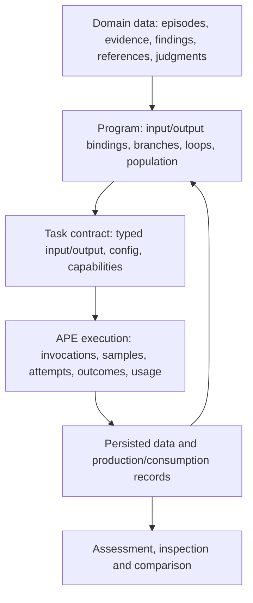

# Design for review: typed data, Tasks, invocations and composition

2026-10-22. **Draft v0.3; proposed architecture, not implemented or approved.**
Revised after Claude's review and the maintainer's clarification of the refactor's purpose.
Sections 1–18 contain the current proposal. Section 19 preserves Claude's reviews verbatim;
[§20](#20-disposition-of-claudes-review) records which recommendations are adopted and why.

**Recommendation:** make a harness an ordinary program over typed data. Tasks describe
operations. Invocations record execution. Assessments are explicit consumers and producers
of data. Standardize these boundaries in APE while leaving reviewing algorithms and
evaluation semantics in the domain package.

**The required outcome is one operational account of the research:** a maintainer can
inspect what was requested, what actually ran, what each operation consumed and produced,
which output was evaluated, and how two reported results differ. Shared implementations
and adoption by the active paths are part of that outcome. Merely adding types or leaving
each probe to assemble this account independently would not complete the refactor.

This is the target architecture that was missing from the
[earlier todo plan](../plans/2026-10-22-task-native-evaluation-and-exploration.md). That
plan remains a requirements inventory; its ordering and compatibility commitments are
subject to this design review. The [systems reading](review-refactor-systems-reading-2026-10-22.md)
provides primary-source evidence and transfer limits. The
[adversarial review](task-dataflow-refactor-adversarial-review-2026-10-22.md) records
counterexamples, revisions and unresolved objections.

## 1. Problem and scope

APE-Bench studies automated review of Mathlib pull requests, including AI-generated
contributions. Lean checks formal correctness, but compilation alone does not establish
that a contribution uses appropriate library abstractions, follows existing conventions,
or is desirable and maintainable. Our experiments therefore concern both how reviewers
investigate these questions and how we establish that their findings are useful.

We need to change how a reviewer acquires information, investigates alternatives, makes
judgments and submits findings, while retaining a clear account of which change was
actually tested and what it achieved. A new idea currently tends to bring a study-specific
export, packet format, matcher, result reader or composition script. Many operations do
not benefit from APE's Task lifecycle, and many handoffs are implicit file conventions.

The problem is not that the code has no data models. It has many typed task inputs,
results, findings, manifests and evidence records. The missing common boundary is:

> Which domain data did this operation consume and produce, independently of the
> invocation that ran it, and how can another operation consume those exact outputs?

Concrete current failures make this a maintenance requirement:

| Observed seam | Consequence for the maintainer | Evidence inspected for v0.3 |
|---|---|---|
| The atomic-obligation judge is versioned in `judge/protocol.py`; the probe matcher uses a raw-ask, setwise rubric imported from `results/` | Similar-looking recovery figures can describe different questions, projections and populations | `analysis/probes.py::MATCHER_RUBRIC`; `judge/protocol.py::JUDGE_PROMPT` |
| `system_prompt_file` and `context_file` are opened by the solo task at execution time | A config path alone does not establish the bytes a resumed or compared reviewer received | `solo.py::solo_system_prompt`, `solo_context_block`; Claude's §19.8 traces the identity gap |
| `PipelineSpec` permits only a generation run and stages reading that run | Acquisition → review → assessment chains need conventions outside that model; the declared graph does not cover the whole study | `schema/runs.py::PipelineSpec` |
| Reconstruction seals score submitted `task_result` findings; later finalization may remove findings | A reported recovery number may concern a different output channel from the published review | [Cheap-baselines discussion](review-reconstruction-cheap-baselines-2026-10-20.md), “The discarded findings” |
| A shared nested-execution primitive once existed without its callers adopting it | A built abstraction did not prevent separate readers, accounting and failure semantics | [Status ledger](../plans/STATUS.md), updated plan step 1, explicitly corrects that earlier claim |

These are reasons to unify the active paths. A quiet generic layer or the presence of
several related schema classes does not show that the system meets this requirement.

The desired architecture must support a solo reviewer, dynamic tool use and delegation,
precomputed assistance, deterministic analyses, external annotations, and alternative
evaluators. It should make these comparable without assuming any one improves reviewing.

This is a research-code architecture, not a new deployment service. It does not propose a
particular number of agents, a fixed review pipeline, a learned quality gate, a universal
convention representation, or a new workflow engine.

### Success criteria

1. A reusable operation has one input/output contract and ordinary APE execution across
   supported scaffolds. New studies do not reimplement clients, retries or usage accounting.
2. Outputs can be consumed, independently assessed, or supplied to another program without
   recovering their meaning from a parent run's directory layout.
3. A reviewer can remain one interactive Task. Decomposed alternatives compose through
   explicit data bindings and can change independently.
4. Execution status, produced content and quality judgments answer separate questions.
5. Population membership, independent samples, filtering, missing work and measurement
   definitions are visible in reports.
6. A small implementation demonstrates these properties on real evaluation and review
   paths before broader extraction. The interface count is not a success measure.
7. From a report row, one shared inspection path reaches the evaluated bytes, instrument,
   population/seal, repetitions, resolved execution settings and upstream data. It shows
   unknowns and failures without requiring the author of the probe to explain its files.
8. A shared comparison path states relevant differences and unsupported claims. Recurring
   execution, context resolution, evaluation and reading logic leaves its bespoke active
   paths as those paths migrate; an unused common helper does not satisfy adoption.

## 2. What the published systems change about this design

Source IDs refer to the [primary-source reading note](review-refactor-systems-reading-2026-10-22.md).
The last column is a requirement on our architecture, not a prediction of reviewer gains.

| Observation | Limit | Requirement |
|---|---|---|
| AutoCommenter separates a location/rule prediction, calibrated thresholds, conditional suppression and feedback (S1) | Learned confidence and Google's feedback differ from our prompted reviewers | Preserve source/rule attribution and publication decisions independently of generated content |
| BitsAI-CR has distinct trained checker/filter, aggregation and annotation/retraining loops (S2) | More prompted stages do not reproduce training or the feedback distribution | Data can move between generation, assessment, policy, annotation and training without changing execution infrastructure |
| RovoDev measures historical alignment, resolution and user feedback separately (S3) | These metrics and gate ablations answer different questions | An assessment names its target, context, protocol and population; metrics retain their definitions |
| Bugbot reports moving from fixed passes to an interactive agent and changing context/tools (S4) | Vendor report, not evidence for a Mathlib effect | Keep interactive control inside a Task; support dynamic composition and exact delivered context |
| Tricorder supports heterogeneous analyzers and resource prerequisites through a common API (S5) | We do not need its RPC/services architecture | Standardize execution and typed handoffs while preserving domain algorithms and resource scope |
| open-code-review shares selection between preview/execution and records selected-item outcomes (S6) | Source behavior does not prove component quality | One resolution path; explicit expected collection; failure/reuse/waiver distinctions |
| CRScore exposes generated-reference and matching failures (S7) | Its pseudo-references are not our gold | Reference construction, matching and independent assessment are separate, inspectable operations |

The sources support both fixed and dynamic reviewing programs. They do not establish one
convergent algorithm that we should freeze into the framework. The PROV-DM distinction
between entities and activities is a useful conceptual precedent for data versus execution;
we do not adopt its full ontology.

## 3. Principles and architecture

**P1. Data has meaning outside its producer.** A finding collection is usable regardless
of whether a solo model, a delegated model, a human import or a deterministic process
produced it. Execution provenance accompanies it without defining its domain schema.

**P2. Operations declare boundaries; programs choose algorithms.** The framework knows
input/output schemas and execution capabilities. A reviewing program chooses retrieval,
decomposition, loops, filtering and finalization. A domain type expresses what its data
claims; typing alone does not make a claim true.

**P3. Execution, validity and usefulness are distinct.** Completing a Task, submitting a
schema-valid object, establishing technical support and making a desirable request are
different observations. A universal `score` must not decide all of them.

**P4. Composition binds values explicitly.** Consumers name exact upstream outputs and
scope. No finding import, implicit path lookup or join may silently substitute another
run's output, lose members, or treat a missing result as a negative conclusion.

**P5. Reuse is a policy, not an equality test.** Identical content, resuming one invocation,
reusing an existing result and obtaining another independent sample are different acts.

**P6. Measure the intended system.** Intermediate data supports diagnosis; final output,
operational failures, required acquisition cost and independent assessment support distinct
end-to-end claims. The report declares which quantity it estimates.

**P7. Preserve evidence without making historical implementation the active API.** Keep
historical artifacts and enough readers for actual uses. Adopt a cleaner contract or
better metric when warranted, recording the boundary. Historical parity is evidence about
a transport refactor; it is not a veto on deliberate semantic changes.

**P8. Optimize for one understandable system.** Total maintenance cost includes duplicated
concepts, exceptions, uncertain comparisons and the work of reconstructing a result. A
shared abstraction earns its place by removing those burdens across actual operations.
The smallest patch and the smallest number of modules are not independent objectives.
Conversely, a new abstraction must replace recurring mechanics rather than add a second
description that callers can ignore. Its name and package are implementation choices;
its contract, owner and adoption are architectural commitments.



The arrows into and out of storage describe data access, not an executing cyclic DAG.
An individual execution's dependency history is recorded as it happens. A program may
loop; successive iterations are distinct invocations.

## 4. Domain data and durable references

A **payload** is an ordinary typed value, initially using the project's existing Pydantic
models. Useful examples are episodes, evidence collections, proposals, findings,
evaluation cases, judgments and publication decisions. Existing `ReviewEpisodeInput`,
finding/decision schemas and judge records are starting points. `EvidenceSet` and
`FindingSet` below are illustrative names for contracts, not instructions to create parallel
schemas. Future developer feedback may use the same boundaries when a real source exists;
no feedback subsystem is in the implementation scope.

An **artifact reference** identifies a persisted payload. Its minimum contract is:

```text
ArtifactRef[T]:
    content_digest       # digest of the stored payload bytes
    encoding             # e.g. versioned canonical JSON, JSONL, text, patch
    schema_id            # stable schema name and version for loading as T
    locator              # resolvable location; not the identity of the bytes
```

`T` helps Python callers and static checking. Runtime loading verifies the digest and
validates the payload against `schema_id`. A generic annotation is not validation. Store
codecs and schema lookup should be small and explicit, with no implicit lossy conversion.
JSON/JSONL canonicalization must be specified once, including ordering where meaningful.
Opaque text and binary artifacts hash their exact bytes.

The existing domain `ArtifactRef` already supplies a path, SHA-256 and optional schema
version. Extend its verified loading/binding behavior on the adopted path before creating
another reference class. The contract above states the required meaning; it does not
require a new class with those exact field names or a new store.

Schema-valid data can still be bound to the wrong episode, revision or construction.
Domain input validation must check relationships between loaded values. For example,
`ReviewInput` checks evidence scope against its episode, and a technical assessment names
the exact patch, imports and environment it checked. Generic reference/type validation
does not establish source applicability or technical truth.

**Data identity and production occurrence are distinct.** Two invocations can produce the
same artifact bytes. Each has a separate production link `(invocation, output field,
artifact)`. A judgment's sampling statistics count occurrences, not unique content hashes.
Producer identity and timestamps live on these links/receipts, not automatically inside
every payload. Domain facts that genuinely include a date retain it in their payload.

A Task has one typed output product. That product may contain named references to larger
products, for example findings and diagnostics. Its fields define the ports; the initial
implementation does not need a generic untyped port registry. Small values can be passed
in memory and materialized at a reusable handoff. We do not persist every expression,
token or transient tool value as a standalone artifact.

**Schema evolution is an operation.** If an old finding is projected into a new schema,
the projection produces new data with a derivation link and a declared conversion. Missing
semantics cannot be manufactured by supplying a plausible enum default. Native historical
payloads remain available to qualified readers.

Storage starts with local immutable payloads and manifests. Existing domain artifacts can
be registered by verified reference before being copied into another location. Existing
`ArtifactRef`, file-operation helpers and Lean content storage must be inspected before
adding byte-store mechanics. Generic APE code must not depend on the Lean toolkit merely
to load JSON. If shared byte operations are extracted, Lean storage can implement the same
small protocol. A new distributed artifact service is out of scope.

## 5. Tasks declare data contracts; APE executes them

Conceptual signature:

```text
Task[I, O]:
    task_type and implementation version
    input schema I
    output schema O
    task-specific configuration schema
    required/allowed capabilities
    submission and intrinsic completion rules
```

Use the existing `BaseTask`, `BaseLeanTask`, data/config classes, submit tools and
TaskOrchestrator. Add an output contract/projection to this system. We do not propose an
`Operation` hierarchy with a separate scheduler that competes with Task.

For existing Tasks, an adapter extracts domain output from the current result subclass.
For new Tasks, keep domain output separate from execution bookkeeping. An initial bridge
may still write a legacy `BaseTaskResult` because current scaffolds require one; the shared
data API exposes the validated domain product and the existing execution outcome
separately. Remove legacy result obligations on the chosen new path when its callers have
migrated, rather than carrying two writable sources of truth indefinitely.

The bridge must validate the legal task-specific submission and its output projection.
`has_result`, a completed status or a file on disk is insufficient: current historical
loading can fall back to a bare `BaseTaskResult`, and synthetic failure results must not
become default/empty domain products. Keep those payloads as diagnostics. Correct any
inconsistent authoritative outcome semantics in APE itself.

Runtime IDs, content digests, usage and provenance are stamped outside the model's
submission fields. Model-visible schemas request domain content only; they should not
expose research conditions, evaluator labels or infrastructure metadata by default.

The base class currently requires `success`/`score` and selects the highest score by
default. These are benchmark-oriented defaults, not universal product semantics. New
composition APIs must not implicitly select by score. Existing Tasks can retain intrinsic
checks: a proof-producing task may use compilation to guide its own loop and recognize a
legal completion. The proposal separates those checks from a post-hoc study metric; it
does not prohibit tool feedback or internal validation.

Small deterministic transformations remain typed Python functions. If their output becomes
a reusable artifact, record their implementation identity, inputs and output in a light
transformation receipt. They need no model conversation, fake score, retry stack or agent
Task registration. Substantial scheduled deterministic work may use Task execution if its
lifecycle benefits from it.

## 6. Invocations, samples, attempts and outputs

An **invocation** is one scheduled execution of a Task under resolved inputs, settings and
resources. It always has an outcome, whether or not it produces a valid output. Use the
existing `TaskOutcome`, sample/attempt records, `UsageBreakdown`, `TaskStorage` and
`ChildRun` as the substrate. The invocation view must be assembled from these records,
not become a second competing status machine.

Whether this view is a reader function, a typed return value or an extension of `ChildRun`
is not a separate architectural decision. All active callers and inspection tools must
agree on its meaning. A second writable invocation lifecycle is excluded.

```text
Invocation[O]:
    invocation_id, parent/program scope, stable call key
    task and effective configuration identities
    input bindings and resource bindings
    sample/attempt references
    existing execution outcome and usage
    zero or one committed output product per execution sample
    output production links and diagnostics
```

Resolve and record the effective request before executing it: actual task configuration,
input content references, prompt/context snapshots, tool interface and resource bindings,
implementation identity and requested sample count. This is a normalized request in the
existing run/sample storage, not another scheduler. A source commit alone is insufficient
for dirty or untracked code and prompt files; preserve the relevant source/content snapshot
or explicitly mark the unresolved part unknown. Execution records then attach observed
attempts, delivered context, usage and outputs to that request.

Separate **a logical repeated sample** from **attempts to complete it**. A continuation or
retry is not an independent repetition. Failed attempts retain their usage and trace.
The engine's retry/continuation semantics remain authoritative; the adapter does not
invent independent samples from resumed attempts.

Separate sampling requests do not establish statistical independence of their errors.
Shared inputs, models and acquisition products can induce correlated outcomes; the study
chooses the reporting/inference unit.

The default new `call` requests one sample and returns its invocation view. A multiple-
sample request returns an explicit collection of sample invocations. Aggregation,
selection or synthesis consumes that collection and produces a new product. The existing
judge's majority policy can be a shared deterministic aggregation operation retaining
every vote. Taking the best observed evaluation score is an explicitly oracle-assisted
policy if that score was unavailable to the deployed program.

APE already implements repeated samples with `sample_count`, and `run_subtasks` already
refuses identical-data specs within one batch. Preserve these mechanisms. The remaining
work is to bind logical calls to their actual scopes/sample slots and expose every sample
to consumers; it is not to invent a second sampling implementation. Growing a task's sample
count after aggregation is currently skipped by the orchestrator and remains an explicit
limit until deliberately changed.

An empty `FindingSet` is valid data. An absent output is not an empty set. A compile failure
can be a valid `TechnicalCheck` output when the task was to test a construction; inability
to acquire the workspace is a resource/execution failure. The domain contract states the
distinction.

Provisional findings or checkpoints may be retained in attempt diagnostics even if the
Task later pauses. Final consumers require a committed final product. An incremental
publication design needs explicit acceptance/withdrawal/finalization semantics; preserving
intermediate bytes does not automatically make them a deployed finding collection.

## 7. Collections are explicit populations

Many current silent errors concern sets of cases rather than individual payload types.
A **collection snapshot** records ordered membership and stable keys, for example an
episode panel or planned evaluation cases. A minimal representation is a manifest of
`(case_key, artifact_ref)` entries with schema, ordering and scope metadata. It is not a
new dataframe engine.

`PairManifest`, dataset manifests and existing scheduled-spec lists already implement
parts of this contract. Reuse them and expose consistent membership/outcome semantics.
A generic collection class is optional; explicit expected membership on every adopted
batch operation is required.

Applying an operation to a collection records an expected row per requested case and
sample, with its invocation, outcome and output reference when present. Filtering creates
a new membership snapshot and preserves exclusion reasons. Missing rows do not vanish
through an inner join. Joins declare keys and expected cardinality; duplicate keys or an
unannounced many-to-many join are errors.

PR, episode, target, obligation, raw comment and finding are different keys. Atomic
obligations and raw maintainer asks remain different reference units until a reviewed
annotation maps them. Similarity grouping is a domain hypothesis/policy, not identity.

Finite planned collections can be sealed before execution. Interactive work discovered at
runtime records child requests as they are scheduled and seals that discovered collection
when the parent closes. We cannot claim in advance to know all questions a dynamic agent
will investigate. An intentionally excluded member, an unscheduled request, a failed
invocation, a completed empty output and an explicit waiver remain distinguishable.

## 8. Programs compose exact outputs in ordinary Python

A program is a Python callable plus resolved input/configuration references and an
execution scope. It uses APE invocation primitives for scheduled work and ordinary typed
functions for deterministic composition. It is not required to subclass Task or declare a
static DAG. A program run records its invocation bindings and implementation identity.

The shared boundary must cover orchestrated review, reusable acquisition, matching and
external-label import. A study may keep its hypothesis, new algorithm and pre-registered
analysis beside its results. It must not need a private runner, packet resolver, matcher
client, seal implementation or run reader to connect recurring operations.

Illustrative API, not implemented classes or a commitment to a `ctx` object:

```python
async def assisted_review(ctx, episode, profile):
    source_run = await ctx.call(
        key="sources", task=collect_sources,
        inputs=AcquisitionInput(episode=episode), execution=profile.sources,
    )
    evidence = ctx.require_output(source_run)
    review_run = await ctx.call(
        key="review", task=solo_review,
        inputs=ReviewInput(episode=episode, evidence=evidence),
        execution=profile.reviewer,
    )
    return ctx.require_output(review_run)
```

`require_output` verifies a legal committed product or propagates the upstream outcome.
It does not replace failure with empty evidence. A fallback to unassisted reviewing must
be explicit and recorded as a branch that changes actual behavior.

Existing `TaskExecutionSpec`, `run_subtasks`, TaskOrchestrator, pipeline adapters and
`StageRecord` can implement this boundary. `ctx.call` is shorthand for their shared
resolution/binding behavior. A thinner function API is equally acceptable if it provides
the same records and makes the recurring paths use them. Leaving ordinary Python scripts
with separate binding/resume/reading conventions does not provide the proposed design.

For an external session or human annotation, an import operation records source bytes,
known execution metadata and unknowns; it does not pretend APE executed the original work.
New automated sessions use an existing scaffold route through Task execution. This lets
legacy observations participate without maintaining a second automated execution path.

The same program API can call a single reviewer with no supplied evidence. A whole
interactive reviewer may retrieve, construct, check and delegate internally. Its
subtasks use the existing nested-execution primitive and produce the same normalized
invocation records. There is no requirement to turn every reasoning step into a Task.

Known independent batches should use TaskOrchestrator batching/concurrency through a
small adapter rather than sequential loops over `TaskRunner`. Dynamic calls may schedule
new batches as their inputs become available. Typed composition determines dependencies;
the existing execution engine owns retries, limits, workers and concurrency.

## 9. Resume, reuse and effects

The initial implementation resumes **at invocation boundaries**. It does not promise
arbitrary Python checkpointing or exactly-once external side effects. Re-entering a
program can resolve existing completed calls, continue an engine-managed paused call, or
schedule new calls according to explicit policy.

The logical call address is `(program_run, call_key, case_key, replicate_key)`. This is a
binding to existing scope/spec/sample identities, not a second physical address space. Explicit
keys, including loop iteration/redispatch keys, are unique within scope. Reusing an address
with different effective inputs/configuration refuses continuation or starts a declared
new scope. It does not silently overwrite the earlier request.

This address must map to distinct actual APE storage/sample slots. The current engine
uses task `global_index` within an orchestrator scope, so two same-input calls cannot be
made independent by changing display names or adding output metadata. A first adapter can
use separate existing orchestrator scopes for repeated identical requests and batch
compatible distinct requests. If execution occurrence keys are later added to engine
storage, that is an explicit APE change with a verified old/new mapping, not a nonce
inserted into model-visible data merely to defeat hashing.

Program source/configuration and recorded inputs are sealed for continuation. A branch
decision that depends on a model or external input must itself be recorded; a deterministic
branch can be recomputed from the same recorded values. Program control must not silently
read the live clock, unversioned directories or network state to choose a resumed path.
The adapter does not enforce purity of arbitrary Python. Programs that cannot meet this
discipline use explicit manual continuation or require a stronger workflow runtime.

| Operation | Meaning | Identity rule |
|---|---|---|
| Resume | Continue the same intended call/sample | Same program scope and explicit call key, verified effective request; preserve attempts |
| Independent sample | Obtain another observation | New sample/replicate identity even for identical input bytes |
| Reuse supplied data | Consume an existing output | Explicit reference and provenance; record original production and new consumption |
| Deterministic memoization | Avoid repeating a known pure transform | Declared implementation, inputs and resource snapshots; optional later optimization |

No automatic cross-study cache of model results is enabled by content equality. Requested
model names may alias changing provider revisions; observed revisions are provenance,
and unresolved versions limit comparability/reuse claims.

Publishing a product has a defined commit point within existing persistence. Prefer the
legal serialized result and its sample/outcome records as the authoritative binding. Add
reference fields there when needed; a separate output-binding file or commit subsystem is
not prescribed. Validate/write referenced payloads before making their product consumable.
Identical re-publication is idempotent; conflicting products for one sample are refused.
Readers require a legal product and consistent authoritative outcome, and recovery must
reconcile interrupted writes before reuse. Unbound bytes are recovery data; missing bytes
behind an accepted reference are incomplete/corrupt output.

Atomic JSON writes already exist in `ape.utils.file_ops`. This is an invariant to enforce
with those primitives, not evidence that a new transaction service is needed. Claude's
§19.2 description of result/outcome writes as occurring under the worker lock is inaccurate:
`worker._try_aggregate` explicitly saves them outside the aggregation lock, in separate
steps. That inspection does not establish an observed crash incident or its frequency.
First fix synthetic failure results and exercise the adopted handoff's interruption
boundaries; extend engine persistence only where a concrete failed invariant requires it.
A provider response lost before persistence can still require a paid retry; exactly-once
provider work is not guaranteed. Uncertain usage is unknown, not zero.

## 10. Resources, visibility and actual context

Immutable domain data and a mutable workspace are different objects. Bind a workspace
through a resource descriptor: repository/base/reviewed revision or snapshot, environment
and tool versions, and the runtime that materializes an isolated working copy. A runtime
handle or absolute scratch path is not portable data identity.

Tool grants, native provider/CLI tools, corpus snapshots, retrieval cutoffs and relevant
store versions are part of the resolved invocation environment. Model-delivered context
is recorded, including selection, rendering and clipping. Tool access records distinguish
what was allowed, attempted and actually returned. A declared capability is not evidence
that a built-in tool successfully searched a symlinked tree.

Prompt/context files are resolved to immutable bytes before the invocation is scheduled;
their paths remain locators. Resume verifies the same content, resolved settings,
renderer and observable tool schemas. The inspection command and execution use the same
resolver. It must show a run's stored initial messages and schemas, rather than reconstruct
them from today's files. Runtime tool responses are additional recorded observations;
previewing the initial prompt cannot predict them. Content hashing without retaining or
resolving those bytes would detect drift without answering what the reviewer actually saw.

Record exact instructions and native context where observable. For opaque provider/CLI
behavior, record the configured route/version and the observability limit; do not claim
byte-identical replay of an undisclosed system prompt or silently pin an unknown model
revision. An unknown environment can permit exploratory execution while limiting reuse,
isolation or comparability claims.

Generation and evaluation use physically separated views/capabilities. Gold references,
future revisions and evaluator-side context must not be mounted into a reviewer merely
because a shared collection manifest lists them. Domain code defines date/exclusion
policy; generic APE executes the grants and records reads. A metadata label or type
annotation is not a sandbox. Scope checks operate at actual workspace/tool routes.
An unrestricted native route that bypasses those checks cannot receive a positive
isolation certification solely from the declared resource manifest.

Provenance visible to the researcher need not be visible to a blinded judge or reviewer.
An anonymous projection keeps its seal separately. A payload may contain untrusted source
text; it must be rendered as source material under the receiving task's instructions.
This proposal does not claim that typing prevents prompt injection.

## 11. Assessments, publication and reporting

An assessment is typed data produced from an exact subject plus an assessment context and
protocol. For Mathlib, separate products can represent historical issue match, resolution
match, raw-ask reach, technical support, desirability and observed developer feedback.
There is no mandatory generic `quality_score: float` shared by all of them.

```text
Findings + ReferenceSnapshot + PairingPolicy
    -> EvaluationCases
EvaluationCase + JudgeProfile
    -> Judgment
ExpectedCases + JudgmentOccurrences + AggregationPolicy
    -> Measurement
```

The evaluation program names a primary instrument for the research objective and any
secondary diagnostics. Its identity covers reference units, scope, input projection,
pairing/selection, code/context, rubric, judge route/settings, sampling, aggregation and
metric definitions. A transport refactor should preserve these; a deliberately better
instrument can change them under a new identity.

Canonicalize the evaluation path across the registered issue/resolution judge and the
recurring raw-ask matcher. Reuse the judge's Task/protocol separation; promote the matcher
to a registered Task with a domain-owned versioned rubric. Both use common request
resolution, exact subject/reference bindings, sampling, sealing, outcome handling and
reporting. They need not share a verdict schema or label semantics. Protocol differences
are explicit data, not a reason for two independent execution/reading systems.

For a study whose registered question is raw maintainer-ask reach, the raw-ask instrument
is the natural primary candidate; existing atomic issue/resolution measurements retain
their meaning. Choose the default on that objective and calibration, not solely because
one instrument has been used more often. Read aligned saved examples, including questions,
partial matches, target mismatches and failures, before declaring a replacement equivalent
or preferable. Distinguish raw versus atomic reference units, setwise versus pairwise
presentation, blind projection and location policy. A primary instrument is declared per
measurement objective before evaluation; active redundant implementations of the same
instrument are retired. Historical instruments need not all remain active forever.

**Publication is a transformation with authority.** Filtering, deduplication, rewriting,
volume limiting and synthesis consume candidates/assessments and produce final findings
plus decisions and lineage. A technical refutation check, a desirability policy and a
format repair have different permissions. New wording is a new assessed subject; it
cannot inherit a semantic verdict merely because its ancestor matched. Preserve exact
surviving text, including coordinated edits and questions if supported by that design.

Evaluation references must not influence generation-side publication decisions. A program
that chooses candidates using gold scores is an oracle diagnostic and must be labelled
as such. Intrinsic compile checks or independently acquired evidence may be used normally.

Every measurement binds an **output channel** and exact subject bytes. The current
reconstruction seals use submitted task findings; downstream finalization can produce a
different published collection. Preserve that historical measurement as submitted-output
recovery. Evaluate the published collection for an end-to-end publication claim, and show
both when analyzing filing/finalization losses. Neither a generic label “final” nor a run
name may conceal this distinction. A transport refactor must not silently re-score a
different channel in pursuit of historical parity.

Reports expose the population, coverage and quantity being estimated. Distinguish:

- Quality conditional on a completed review with valid output.
- End-to-end performance over every requested episode, including operational failures
  under an explicitly declared treatment of those failures.
- Historical recovery, independently assessed correctness/desirability, and comment volume.
- Cost to run the complete program, component cost, and any amortization of shared inputs.

An execution failure is not a negative judge verdict. A study can count an unavailable
reviewer as a failure in a deployment metric while separately reporting conditional
recall. Unjudged cases, incomplete references and no-gold PRs must not be converted into
known incorrect findings. The selected estimand and failure policy travel with the metric.

### Required inspection and comparison

One run/program record is the entry point to existing authoritative records. It names
resolved requests, input/output bindings, requested cases/samples, observed execution and
assessment/report references. Fixed requests are recorded before execution; dynamic work
is appended as requested. The record can be a manifest plus readers over existing storage;
there is no requirement for another event store, database or universal `Experiment` class.
Its absence cannot be delegated to the study author's narrative.

Shared inspection and comparison functions, exposed through the existing CLI, must answer:

| Maintainer question | Required answer |
|---|---|
| What exactly ran? | Resolved settings and code/content identity, route, requested/scheduled work, actual attempts, failures, reused/imported data and unknowns |
| What did this reviewer see? | Stored initial messages, observable instructions/tool schemas, scoped resource versions and delivered tool/context records; explicit opaque portions |
| What does this table row measure? | Exact subject/channel, instrument and version, reference population, seal/projection, denominator, sample occurrences, aggregation and missingness policy |
| Why do two results differ? | Relevant input/configuration/context, population, output-channel and instrument differences, with links to their bindings |
| What can I conclude from the comparison? | Which quantities have the same definition, whether paired cases/repetitions align, what pooling is refused, and which causal claims remain unsupported |

All generated numeric tables carry this measurement identity or an unambiguous link to it.
A rule telling agents to remember the instrument is useful but insufficient; reporting
code emits it. Equality of all fields is not a universal comparability test: a treatment
is intentionally different. The comparison names the intended contrast and differences
outside it. Different instruments may be displayed side by side with their definitions;
their numbers are not silently subtracted or pooled as one metric. A model/route contrast
can be descriptive without establishing an isolated harness effect.

The normalized record/readers must land with the first adopted evaluation path. They are
not a final visualization task after the execution refactor. Historical runs can be
indexed/imported with explicit unknowns; backfilling perfect provenance is not required
before prospective work uses the common path.

## 12. Required extension scenarios

| Scenario | Composition and data requirement | What must remain observable |
|---|---|---|
| Whole-PR solo baseline | One Task consumes episode plus scoped resources, produces final findings | Empty versus absent output, actual context/tools, all samples |
| Evidence assistance | Acquisition output is supplied to the same reviewer | Exact evidence and rendering; acquisition failures/cost; explicit fallback |
| Dynamic delegated review | Parent Task schedules typed children and synthesizes | Every scheduled child, attempts/usage, consumed child outputs, synthesis lineage |
| Alternative construction and testing | Exact proposed patch/imports/prerequisites feed a check | What was tested, failed prerequisites, repairs; no automatic desirability conclusion |
| Independent assessment | Same final findings feed technical, historical and human assessments | Blinding, reference provenance, missing labels, protocol differences |
| Policy/calibration change | Fixed candidates/assessments feed another publication policy | Suppressed and rewritten content, policy version; changed final output |
| Training or convention induction | Dated annotation/evidence collections produce a learned component/rule | Training membership, cutoff/exposure, artifact version, held-out assessment |

The framework promises executable boundaries and evidence, not that the proposed internal
decomposition is causally optimal. Some experiments should compare an entire configuration;
others can hold a typed intermediate product fixed to isolate a narrower question.

## 13. Current code: retain, change, retire

Inspected checkout: `develop` at `4695a1b1`, including existing dirty research documents.
Newer reconstruction artifacts at `review-reconstruction@eecb7d18` inform requirements,
not claims that their branch-specific code is integrated here.

| Current seam | Existing coverage | New work/adoption obligation |
|---|---|---|
| `BaseTask` input/config/result, scaffolds/runtime | Execution and typed submissions exist | Add validated domain output projection; fix effective configuration resolution |
| Outcomes, samples, attempts, usage, `ChildRun` | Execution state and useful readers exist | One request/output view consumed by all adopted paths; correct synthetic-result semantics in the engine |
| `run_subtasks`, `sample_count` | Nested execution, duplicate-spec refusal and repeated samples exist | Reuse them; bind calls to scopes/samples and expose occurrences without implicit best-score selection |
| `ArtifactRef`, domain schemas, dataset/pair manifests | Many typed payloads, hashes and populations exist | Verified loading, scope checks and one interoperable binding contract; no parallel schema family |
| `StageInput`, `StageRecord` | Existing run/audit consumers hash declared artifacts and record handoffs | Extend bindings beyond one generation run and expose the full adopted chain |
| `PipelineSpec`, adapters, generic `run_pipeline` | Static scheduling and generation-rooted command graph exist | Support acquisition/review/assessment handoffs with the same execution records; ordinary Python remains available |
| `DESIGNS`, submit tools | Review designs own submission contracts | Product projections preserve supported questions, constructions and coordinated subjects; no central algorithm cross-product |
| Issue/resolution protocol, registered judge, `report conditions` | Shared rubric, judging and several population/identity refusals exist | Register recurring raw-ask matching; share evaluation execution/sealing/reporting with explicit protocol differences |
| Solo prompt/context paths and route packets | Renderers, packets, traces and post-execution hashes exist | One content resolver used before execution and by inspection; seal actual observable interfaces |
| Lean content storage and snapshots | Domain resource/storage mechanics exist | Adapt resources and reuse byte primitives; extract only needed generic operations |
| Probe-local runners, matchers, seal/import/read scripts | Studies can be executed through bespoke chains | Migrate recurring mechanics into the common path; retain study-specific analyses and historical evidence |

APE owns task execution, resolved execution requests and their lifecycle/output bindings.
Mathlib owns its payloads, evaluation protocols, comparing metric meanings and reviewing
programs. Begin in existing modules where cohesive. A new module or a generic extraction
is warranted when that ownership and actual consumers require it; the number of research
domains is not itself the criterion. A reviewer, collector and matcher can already be
different operations sharing framework mechanics. Domain data modules must not eagerly
import the task registry or Lean toolkits. Architectural ratchets may change explicitly
when they obstruct the chosen boundary; literal class/module counts do not define it.

### Relationship to the October 6 redesign

The [October 6 record](codebase-redesign-2026-10.md) is an implementation baseline, not a
failed design to replace wholesale. Its step 5, “the stage as the probe unit,” already
targets packets, seals and matching. This proposal completes that adoption goal and makes
the consumed/produced data and maintainer inspection contract explicit.

| Prior decision | Disposition here |
|---|---|
| One APE executor; explicit registration; strict typed config; design-owned submissions | Retain; no replacement scheduler, discovery framework or unvalidated parameter mapping |
| Producers, one reading spine and a shared probe-stage seam | Retain and use; schema existence is distinguished from adoption across active paths |
| Study-specific analyses remain beside their results | Retain; recurring execution, matching, sealing and identity mechanics receive a shared owner |
| One generation-rooted command pipeline | Preserve existing readers; generalize the prospective composition boundary where stages consume each other's products |
| A new abstraction must prove useful on real work | Retain, with maintainer reconstruction/comparison and a second distinct composition as acceptance criteria |
| No new module, unchanged count ratchets, and only the immediate experiment's needs | Not architectural constraints; update protections deliberately when a coherent common boundary needs them |

The demonstrated-change thread is a valuable consumer, not the definition of all future
operations. The reconstruction/cheap-baselines thread is a second current consumer with
different acquisition and evaluation handoffs. Infrastructure fixes are measured as
infrastructure fixes; a reviewer gain is not required to establish that a run is now
identifiable or a recurring matcher is no longer duplicated. Conversely, those fixes do
not establish a scientific gain.

This is a behavioral boundary change, not a package-renaming project. The implementation
should demonstrate an input/output contract before choosing an extensive directory layout.

## 14. Alternatives and tradeoffs

| Design | Advantage | Reason to reject or limit it |
|---|---|---|
| Only stricter configs and better scripts | Lowest initial cost; may be enough for isolated studies | Leaves producer-specific results and implicit composition as the recurring integration boundary |
| Typed references plus ordinary programs, proposed | Supports one Task or many, data reuse and assessment, with existing execution | Requires precise identity/publication semantics; Python program resume has limits |
| Declarative DAG/workflow engine as core | Strong static planning, visualization, distributed stage management | Adds an executor surface and constrains dynamic loops; does not itself define domain data or measurement |
| One prescribed review architecture | Simplifies a production implementation | Fixes the algorithm we need to compare and redesign; poor fit for harness research |
| Universal evidence/claim/PR knowledge graph | Rich cross-cutting queries | Expensive ontology and migration, speculative applicability; no demonstrated need for the first slice |

Reconsider a mature workflow engine if durable cross-process program control becomes the
main bottleneck. Reconsider a query database when manifests cannot answer actual workload
queries efficiently. Do not build either merely to make the architecture diagram complete.

## 15. Bounded implementation and acceptance

Adopt the target through coherent slices. A slice has a consumer and removes the recurring
special cases in its scope. Scope can be narrowed or reordered; the maintainer contract
must remain explicit, rather than vanish each time a caller can temporarily work around it.

| Slice | Depends on | Existing base and main merge surface | Deliverable/acceptance on real work |
|---|---|---|---|
| 0: correct execution semantics | None; fixes may land independently | `tasks/base.py`, worker/outcome persistence, affected tool outcome reader | Effective task config reaches reconstructed tasks; unknown config keys refuse; all-failed tasks expose failure and usage without a fake legal product; missing checks remain missing |
| A1: common evaluation and result inspection | Slice 0 where execution/config semantics are used | Existing judge Task/protocol/reporting, matcher code in `analysis/probes.py`, domain schemas | Registered raw-ask matcher and existing judge use shared binding/sealing/reporting mechanics; each generated row identifies its subject/channel, protocol, population/seal and repetitions; one reader traces it to exact bytes |
| A2: resolved context and run inspection | Slice 0 for effective settings; can proceed alongside A1 | Existing run-plan resolution, solo renderer, scaffold/tool-schema preparation | Prompt/context content is sealed before work; execution and inspection share the resolver; an edited brief cannot silently resume; inspect displays stored observable inputs and marks opaque context |
| B: shared composition in two current consumers | A1 and A2; define their small binding contract together | Existing pipeline adapters, `StageInput`/`StageRecord`, orchestrator/subtasks and one recurring producer | A demonstrated-change solo program and a reconstruction/evidence-assisted program use the same request/output/assessment records; acquisition can be replaced without private run/seal/read logic |
| C: broader dynamic and recovery coverage | B; required failure checks also apply within every preceding slice | Existing child/sample persistence and resource adapters | A nested failure, resumed sample, fresh repetition, interrupted output, explicit fallback and external-label import stay identifiable; unsupported continuation fails explicitly |

Retirement is part of each slice's completion, not a final optional cleanup. Historical
scripts and artifacts remain readable under their original definitions. Active callers of
superseded mechanics migrate, or are listed as a named remaining adoption gap with an owner
and completion criterion. A migrated path calls the shared implementation rather than
copying it. Inspection can initially be a textual/JSON CLI view; a dashboard is unnecessary.

Use two current consumers deliberately. [Demonstrated change](../todo/review-as-demonstrated-change.md)
tests a reviewer with a verified construction, unbuilt concerns and failed attempts.
[Reconstruction/cheap baselines](review-reconstruction-cheap-baselines-2026-10-20.md)
tests acquired assistance, route/context differences, seals and submitted/published output.
They discriminate between a generally useful handoff and a one-study adapter. Their next
paid experiments need not wait for the entire refactor: whichever path migrates first gets
a declared scope and the prospective record contract; remaining work is visible.

Before implementing B, walk these consumers through the selected existing APIs with saved
inputs and list the binding/reader mechanics that remain bespoke. This is an implementation
spike, not another reviewer study. Choose a thin adapter or an engine extension from that
evidence. Do not require a hypothetical third domain before fixing a shared lifecycle gap.

Cost is concentrated in adoption, context resolution and hub changes, not in declaring
`product()`. A1/A2 are the first integration milestones; B's composition/storage changes
have greater uncertainty. Keep framework bug fixes, domain protocol changes and caller
migrations separately reviewable. Before runtime work, map the relevant in-flight branches,
agree the shared schema/runner interface and budget each milestone against that concrete
surface. Historical commit counts are not an estimate for this revised design. Low recent
churn does not establish that an execution or identity boundary is adequate.

Acceptance includes these falsifiable checks:

- Independent identical outputs remain two observations; resume does not mint a repetition.
- A stale source, unsupported schema or missing required output fails before consumption.
- Same-shaped evidence from another episode and a check of another patch fail the domain
  binding validator before any downstream paid call.
- Interrupted output publication recovers a consistent binding/outcome or remains visibly
  incomplete; conflicting concurrent publications do not silently select one.
- The same sealed cases and recorded judgments give the same report after an execution
  refactor; changed semantics get an explicitly different protocol/report.
- A whole-PR reviewer and an assisted program both run through the same execution system
  and project to the same supported final-finding contract.
- A program can change a component and declared configuration without editing the common
  runner's condition-specific branches.
- A maintainer can follow one evaluation row through the shared reader to exact submitted
  or published bytes and all resolved inputs; another reader is not required per study.
- Editing one prompt/context byte changes the effective request or refuses resume; viewing
  an old run still shows its original bytes and observable tool interface.
- Comparing saved runs shows differing channels, protocols, populations, seals and routes;
  it refuses unsupported pooling while permitting explicitly described contrasts.
- The second consumer adds its algorithm/configuration and domain contract extensions as
  needed, without copying evaluation, context resolution, execution or run-reading code.
- Artifact/receipt writes are bounded at actual handoffs; measure local read/write and
  orchestration overhead on realistic saved outputs before broad adoption.

API generation, ingestion and semantic judging are user-run. Offline fixtures can establish
composition, identity and deterministic report behavior; calibration and reviewer gains
require separate model/human evaluation. Runtime implementation is outside this document's
current authorization.

## 16. Decisions needing criticism

1. Is one typed output product with nested references enough, or do real existing Tasks
   require independently committed named outputs? Start with one product and keep
   provisional outputs explicitly nonfinal until a concrete counterexample warrants more.
2. Can invocation-boundary resume support our actual Python programs without a new durable
   workflow runtime? Test dynamic branching and interrupted publication before broad reuse.
3. Which existing payloads should become the canonical prospective findings and reference
   contracts? Choose by the research objective, not by minimizing historical conversions.
4. How much generic reference/storage code should be extracted now? The first slice should
   prove the contract using real artifacts before committing to a storage hierarchy.
5. What minimal resource/input completeness is required for reuse, and how should unknown
   environment versions qualify a comparison rather than prevent all research execution?
6. Can this simplify active code enough to offset manifests, adapters and schema versions?
   Count eliminated recurring mechanics and exercise a second real program before expanding.
7. Does the chosen common record make the maintainer's actual questions answerable without
   another interpretation layer? Evaluate this on submitted/published findings and two
   different instruments, not only a clean one-reviewer/one-judge example.

## 17. Brief for an independent reviewer

Read this document first, then the linked systems reading and adversarial review. Inspect
the following current contracts before endorsing a replacement:

- `src/ape/tasks/base.py`: data/result contracts, configuration resolution, default aggregation.
- `src/ape/orchestration/models.py`, `subtasks.py`, `persistence.py`: outcomes, samples,
  nested execution and actual result persistence.
- `src/mathlib_review/schema/identity.py`, `runs.py`, `findings.py`: existing data and
  pipeline boundaries.
- `src/mathlib_review/judge/protocol.py`, `runner.py`, `semantic_judge.py`, and the
  registered `src/ape/tasks/lean_tasks/formal_math/review/judgment.py`.
- The October 6 redesign's implementation record, the earlier todo plan, and the
  cheap-baselines document for a near-term consumer.

Suggested review prompt:

> Review this as an architecture proposal, not as an implementation to polish. Try to
> construct cases where data identity, invocation identity, typing, population accounting,
> dynamic composition, resource scope, output publication or assessment semantics fail.
> Compare it with a materially simpler design using the existing APE contracts. Distinguish
> obligations already implemented from new work. Check primary-source claims before using
> them to justify an algorithm. For each substantive objection, give a concrete scenario,
> consequence, proposed alternative and discrimination/acceptance check. State which
> abstractions should be removed, changed or retained and why. Do not assume a fixed DAG,
> multi-agent review or perfect historical compatibility is desirable. End with a proposed
> smallest implementation slice and any unresolved objections that should block it.

The alternative must cover the maintainer queries in §11 across both current consumers.
Count bespoke paths and reconstruction work as costs, alongside abstraction and migration
cost. “A similar type already exists” is an implementation lead; show how actual callers
share and enforce its contract before treating that as a solved requirement. Conversely,
do not defend a new class when a shared function over existing records supplies the same
contract. A small first implementation should advance the target, not redefine it around
whatever one immediate experiment can avoid using.

The review may reject the recommended architecture. A useful alternative has clearer
contracts and fewer bespoke paths with demonstrated coverage of the required scenarios.
Its implementation may be smaller or broader than this proposal.

## 18. Revision record

- **v0.1:** initial target architecture after the primary-source reading.
- **v0.2:** incorporated the author-conducted adversarial pass: explicit occurrence-to-
  execution mapping, bounded Python continuation and branch recording, output commit and
  recovery semantics, cross-value scope checks, legacy result validation, model-visible
  metadata separation, opaque-route limits and provisional-output boundaries. See A1–A9
  in the linked review for concrete counterexamples and acceptance obligations.
- **v0.3:** incorporated Claude's source-level corrections and the maintainer's clarification:
  one adopted operational account is a requirement; inspection/comparison move into the
  first slice; existing sampling and records are reused; no separate commit subsystem is
  prescribed; output channels and content-resolved context are explicit; two current
  consumers exercise the shared boundary. See §20 for review dispositions.

These are specification revisions. Claude's independent review follows. Runtime
implementation, fault injection, judge calibration and reviewer-quality evaluation remain
outstanding; no scientific gain is established by this revision.

## 19. Independent review (Claude, 2026-10-22)

Read against `develop` at `4695a1b1`, with the October 6 redesign
(`codebase-redesign-2026-10.md`, §§3, 4, 11), the September typed-handoffs plan and its rows
in `docs/plans/STATUS.md`, `docs/dead-ends.md`, `docs/todo/`, and every file the §17 brief
names. "Checked" below means the source was read at the cited lines. Nothing was run.

### 19.1 Verdict

The principles P1 to P7 are right, and most of them are already this codebase's rules. As a
statement of invariants the document is useful and should be kept. As a refactor plan it is
not yet admissible, for four reasons.

1. **It does not engage with the October 6 record.** That review rejected a five-registry
   redesign on evidence and kept the rejections (§3), built three seams each with a threshold
   measured on the next piece of real work (§11), and left one step unbuilt on purpose: "the
   stage as the probe unit" (§4.6, step 5), which waits for the next probe that launches
   sessions by hand. Step 5 is this document's problem statement (probe-local matchers, exports
   and readers) with a plan and a threshold already attached. The document should say which
   October 6 verdicts it inherits, which it overturns, and on what evidence.
2. **Its acceptance checks are properties of the infrastructure.** The October 6 discipline, a
   threshold stated on the next piece of real work before the step starts, is absent. The next
   piece of real work on record is the demonstrated-change design
   (`docs/todo/review-as-demonstrated-change.md`, 2026-10-18). Sized against it, most of this
   design is off the path (19.4).
3. **"Addressed in §X" means the specification was amended, not that code exists.** Several
   "required changes" are already built, and the document does not say so, so a reader cannot
   tell new work from existing work (19.3).
4. **Cost and merge surface are unstated.** The layer this touches, `src/ape/orchestration/`
   and `tasks/base.py`, has had one commit since October 6 (`knob()`); it is the quiet layer the
   September plan fixed. Two other sessions share this working tree, 44 worktrees exist and
   several are unmerged. October 6 estimated 35 to 50 commits for three seams and gated the hub
   steps on in-flight branches merging first.

### 19.2 The objects, one by one

| Proposed (§) | Already in the tree | Verdict |
|---|---|---|
| Typed payloads (§4) | The `StrictModel` family in `src/mathlib_review/schema/`, 133 exported names, each record carrying a `schema_version` literal | Exists. Nothing to build. |
| `ArtifactRef[T]` with digest, encoding, schema id, locator (§4) | `schema/identity.ArtifactRef` (path, sha256, role, schema_version, records). `StageInput.at(require=...)` hashes exactly the artifacts a stage consumes. `PairManifest` and the judge data carry source hashes and refuse a mismatch. | Exists, minus a verify-on-load helper. Add `load(ref, model)` beside the existing class. Do not move it into `src/ape/` until a second task family consumes it; the plan's own ownership table says the same. |
| Task output contract and projection (§5) | `BaseTask.data_class`, `task_config_class`, `task_result_class`; `candidate_from_finding` (`judge/runner.py:115`) is the final-finding projection for review designs | **The one new object worth building**: a validated `product()` on the result class, separate from `success` and `score`. Prove it on the judge handoff. |
| `Invocation[O]` (§6) | `TaskOutcome`, `Sample` and `Attempt`, `ChildRun`, `execution_index.jsonl`, `StageRecord` | A reader function, not a type. §6 already says it must be assembled from the existing records; then it should not appear in the object list as a thing to build. |
| Collection snapshot (§7) | `PairManifest` (planned judge units), `RunManifest.coverage_gaps` and the `StageInput` refusal of a partial run, the sealed agenda, `configs/probe_sets/`, `DatasetManifest.pr_numbers` | Exists per domain. The generic `(case_key, artifact_ref)` manifest has no consumer. The join-cardinality rule is a test on `report conditions`, not an object. |
| Program, `ctx.call`, `require_output` (§§8, 9) | `run_subtasks` for nested work; `cli pipeline` for a static stage graph; plain Python beside each probe, which October 6 amended from "cells as YAML" to "a `cells.py` may yield cells" | Not justified yet. Its hard part, the call-key to orchestrator-scope mapping (§9, A1), is a scheduler surface under another name. Admissible only after Slice B counts the mechanics it removes. |
| Output-binding record and commit protocol (§9) | The worker writes `task_result.json` and `task_outcome.json` under its lock; `execution_index.jsonl` and the lead journal are append-only so a crash leaves what ran findable | No recorded instance of bytes and receipt disagreeing. The one recorded inconsistency of this family is framework defect 4 (a synthesised failure written with `has_result=True`), a one-commit fix on the todo since 2026-09-22. Fix that; do not build a protocol for a hypothetical. |
| Assessment chain (§11) | `EvaluationProtocol`, `PairManifest`, `EvaluationReceipt`, sealed `SemanticPair`s, the registered judge Task, `report conditions` with its denominator and judge-identity refusals | Exists for the atomic-obligation path. What is missing is a decision, not code: whether the raw-ask matcher (`analysis/probes.py`: `seal_labels`, `match_inputs`, `unblind`, `matcher_rubric`) becomes a named instrument. That is E1, and it is research. |
| `PublicationDecision`, `FeedbackEvent` (§§4, 11) | `CandidateRejection`, `SynthesisDecision`, `ConflictRecord` (`schema/findings.py`); `filing_contract.Cell`, `Evidence`, `EvidenceEdit`; `cli adjudicate` (built, empty at the September status row) | Decisions exist under other names. `FeedbackEvent` has no data source: there is no deployed reviewer. Out. |

Count: nine objects proposed; four exist, two are views over existing records, one is new and
justified narrowly (the product projection), two are new and unjustified (the program API, the
commit protocol).

### 19.3 Claims checked against the tree

| Claim (§) | Where | Result |
|---|---|---|
| Task storage and resume are keyed by `global_index` (§9, A1) | `orchestrator.py:167-187` | True. And `run_subtasks` (`subtasks.py`) already refuses two specs with identical task data, with a message saying why. The collapse is loud, not silent. |
| Two identical requests cannot be independent samples (§6, A1) | `orchestrator.py:73, 209` | Incomplete. `sample_count` is the existing independent-sample primitive; the judge docstring relies on it for repeated verdicts. The real residual: a task with `task_result.json` is skipped, so a sample cannot be added to an aggregated task without removing the aggregate, which only `requeue_failed_samples` does today. |
| Historical loading falls back to a bare `BaseTaskResult` (§5, A7) | `persistence.py:117-127` | True for attempt results. `ChildRun` already distinguishes: `succeeded` is `result is not None`, and the synthetic failure goes to `error`. The orchestrator's own `_aggregate_final_results` (`orchestrator.py:459-460`) still loads a failure as `BaseTaskResult` and counts it completed. |
| The worker synthesises a failure result (§5) | `worker.py:674-697` | True: `success=False, score=0.0, error="All samples failed"` is written, then `has_result=True`. Framework defect 4. |
| `create_task_from_data` drops unknown keys before strict validation and never reads `config.task_config` (§13, F1) | `tasks/base.py:743-748` | True. Framework defect 1, recorded in September; both nested judges have run on their config defaults since. One commit. |
| `BaseTask` requires `success` and `score` and aggregates by highest score (§5) | `base.py:172-173, 618-623` | True. `aggregate_results` is overridable per task class; the review tasks' overrides were not read here. |
| `PipelineSpec` allows one generation run (§13) | `schema/runs.py:305-339` | True, and deliberate: "a stage reads a generation RUN, not another stage's output". Multi-stage chains are the stage-chaining and pipeline-streaming todos. |
| New ideas bring study-specific exports, matchers and readers (§1) | `results/pr_review_v5/probes/`: 50 directories, 149 scripts outside `tmp/`, 39 importing from `src/`; the reconstruction probe alone 15 scripts, 2,078 lines, 3 importing from `src/` | True. October 6 measured the same (112 scripts, 84 importing nothing) and §3 rejected "no code in `results/`", because pre-registered analyses belong beside their results. What it proposed instead is one seal function, one reading spine, and the stage as the probe unit. |
| The generic layer is where the churn is (implied by §13) | `git log --oneline --since=2026-10-06 -- src/ape/orchestration src/ape/tasks/base.py` | One commit. The hubs are `review/runner.py` (2,225 lines), `analysis/probes.py` (1,469) and `review/cli.py` (857). A refactor of the quiet layer does not touch the width. |

### 19.4 What the next experiment needs from this

The demonstrated-change design needs: `filing_contract` extended so a candidate is filed only
with a verified construction attached, and a named concern without one recorded as unbuilt
with its failed attempts, stored per sample; three reps of the free reviewer on the 26
ask-reading PRs; one seal and the two blind matchers through the existing `match` and `seal`
path; a per-ask table against solo's three reps on disk.

From this design it needs three things: O1 (a failed check with missing prerequisites must not
read as a refutation of the intended change), a result-side field for unbuilt concerns, and a
named instrument for the raw-ask matcher (E1). It does not need a program API, invocation
views, collection snapshots, a commit protocol, or an `ArtifactRef` in APE.

### 19.5 The smallest slice, with thresholds stated first (superseded by 19.8)

| Step | What | Threshold, stated before the step | Size |
|---|---|---|---|
| 0 | Framework fixes, one commit each, each with an offline test: F1 (seed from `config.task_config`, refuse unknown keys); defect 4 (stop writing the synthetic result, or amend the rule and the `TaskOutcome.has_result` docstring to say it is deliberate); O1 (a missing tool result is `missing`, never `answered`) | the nested judge receives its `judge_mode`; a task whose samples all failed has `has_result=False`; an interrupted call is reported missing | 3 commits |
| A | `product()` on the judge result, consumed by `report conditions` | byte-identical `report conditions` on the three hygiene reps; no new module; the package-boundary ratchets unchanged | 3 to 5 commits |
| E1 | A half-day reading, not code: does the demonstrated-change thread score with the atomic judge or the raw-ask matcher; name the instrument; move its rubric from `results/` into `src/` (October 6's "one seal function") | the demonstrated-change plan names its instrument before its first rep | 1 to 2 commits |
| B and after | Only when the demonstrated-change thread needs it, judged by October 6 step 5's threshold unchanged: the thread lands with no new `cli probe` subcommand, no `probes.py` edit, and no new result reader under `results/` | | |

### 19.6 Answers to §16

1. One product with nested references is enough for every current Task. The demonstrated-change
   finding (edit, compile result, failed attempts) is a nested product. No counterexample is on
   record.
2. Invocation-boundary resume is what `cli pipeline` does at stage grain and the orchestrator
   at sample grain. No program on record needs more. Do not build `ctx`.
3. `ReviewFinding` and `CandidateClaim` for findings, atomic `ReviewIssue` obligations for the
   judge. The raw-ask matcher is a second instrument that E1 names or retires.
4. Extract nothing into `src/ape/` now. One consumer is not a protocol.
5. Record what is known, mark the rest unknown, and let `report conditions` refuse pooling across
   a difference. That is the existing judge-identity refusal, generalised one field at a time.
6. It cannot offset manifests and adapters unless Slice B shows the count. The October 6 record
   says half of thread width is shared-machinery fixes that no architecture removes.

### 19.7 Not checked

The seven primary sources were not re-fetched. The review tasks' own `aggregate_results`
overrides were not read. No test was run. The `demonstrated-change` branch's code was not read
beyond the todo file.

### 19.8 Correction, after the user's question (2026-10-22, later the same day)

The user asked how 19.1 to 19.6 explain the friction they live with: the hand-rolled matchers
and the judge give overlapping but distinct answers; it is hard to tell which result is being
reported and how two reports compare; it is hard to tell what a reviewer was shown after a
brief was edited; it is hard to tell what exactly ran. They are right, and 19.2's "exists under
another name" is the symptom, not a defence. What follows was checked in the tree after the
question.

**Two instruments, and nothing in the tree says which is primary.** The registered judge
scores one finding against one atomic gold obligation, pairwise, and reports hits out of 23.
The matcher scores a raw maintainer ask against all of one reviewer's findings at once, from a
hand-launched Claude session over a folder, and reports reach as a fraction of asks. They
forked on 2026-09-29. As far as the code shows, the judge needs atomic obligations, which
exist for the dev and held-out sets only, and anchored pairing from an orchestrated run; the
new sets carry raw asks, and subscription-route sessions ran outside the orchestrator, so the
judge could not run there. The matcher was written in that probe's directory, and the kernel
now imports its rubric from it (`analysis/probes.py:782`).

| Instrument | Probes using it since 2026-09-29 (by their protocol, readme or results) | Rubric |
|---|---|---|
| Judge | 4 | `src/mathlib_review/judge/protocol.py`, `JUDGE_VERSION` |
| Matcher | 14 (one probe used both) | `results/.../gpt52-postcutoff-2026-09-29/matcher_rubric.md`, plus 10 copies and variants in other probe directories |

So the matcher is the working instrument and the judge is the documented one: CLAUDE.md's
reporting section speaks only the judge's vocabulary, and `questions.md` reports both side by
side. A reach figure is meaningful only within one seal, of which there are seven (the same
Claude sessions read 0.27 to 0.39 across them), and the seal is not part of the figure's name.
That is the structural half of "which results are you reporting". The behavioural half is
agents quoting a number without its instrument, set, seal and denominator.

**Briefs are data addressed by path, not by content.** A solo reviewer's visible text is the
design template in source, the brief named by `system_prompt_file`, the per-PR sections named
by `context_file`, producer sections and tool grants from the config, the route's own system
prompt, and the tool schema text. Only the template and the tool names enter the run's
identity. The two files are paths read at execution time (`solo.py:231-357`); their bytes
reach only `rendered_prompt_sha256` on rows written afterwards; and a `task_config` key sits
in the resumable scaffold digest (October 6 §1.4), so editing a brief at the same path forks
nothing and refuses no resume. Twenty configs name a prompt or context file under `results/`;
ten name a system prompt file. The Claude Code route reads `brief.md` and `model.md` from a
packet folder outside the orchestrator (`probes.py:278, 631-632`) under an undisclosed system
prompt, and the tool schemas an arm is shown are sealed nowhere (framework defects,
2026-09-23). Answering "what did this reviewer see" means reading four to six places and a
transcript.

**Each probe is a bespoke chain described only in its own protocol.** Gate shell scripts,
hand-launched sessions, seals, importers and readers, with the record split between the
orchestrator's directory and the probe's folder. October 6 named the fix, the stage as the
probe unit with packets, seals and matching in the kernel, and deferred it "until the next
probe that launches sessions by hand". Fourteen probes since have launched sessions by hand.

**What this corrects above.**

- 19.2, assessment chain: "what is missing is a decision, not code" was wrong in emphasis.
  The decision needs code to stick: a registered Task and a versioned rubric in `src/`. It is
  the most valuable step of the refactor, not a side question.
- 19.4 stands: the next experiment does not need the program API, invocation views, collection
  snapshots or a commit protocol. It needs the instrument settled first.
- 19.5 is superseded by the table below. 19.6 answer 3 becomes: the matcher's semantics (raw
  asks, setwise, reached / partial / no) is what fourteen probes and the next experiment use;
  make it the primary instrument with a version, keep the judge for the frozen record, and
  publish a table saying the two are not comparable.

**The smallest slice, revised.**

| Step | What | Threshold, stated before the step | Size |
|---|---|---|---|
| 0 | Framework fixes as in 19.5: F1, defect 4, O1 | as in 19.5 | 3 commits |
| 1 | The instrument: the matcher as a registered Task with a `MATCHER_VERSION`, its rubric moved from the probe directory into `src/`, run through the orchestrator so resume is its cache, the seal as one kernel function, the judge kept for the frozen record with a compatibility table that says the two are not comparable. A reporting rule in CLAUDE.md: every number carries instrument and version, set, seal id, denominator and repetitions. | the demonstrated-change thread's first rep is scored through it with no hand-launched matcher session and no new rubric copy; `questions.md` entries written after it name the instrument | 5 to 8 commits |
| 2 | Content-addressed briefs: the sha256 of `system_prompt_file` and `context_file` sealed outside the resumable plan fields, so an edited brief forks the run and a resume refuses it; one command that prints the exact assembled text one PR's reviewer sees under one config, with the route's undisclosed part stated as such | editing one byte of a brief refuses a resume; the command's output hashes to a run's recorded `rendered_prompt_sha256` | 3 to 4 commits |
| A | The product projection on the judge and matcher results, consumed by `report conditions` | byte-identical `report conditions` on the three hygiene reps | 3 to 5 commits |
| then | The stage as the probe unit, October 6 step 5, measured on the demonstrated-change thread | that thread lands with no new `cli probe` subcommand, no `probes.py` edit, no new reader under `results/` | per October 6 |

The program API and the invocation views do none of this and stay out.

## 20. Disposition of Claude's review

**Author's response, 2026-10-22; reflected in v0.3 above.** Claude's appended sections are
preserved as review evidence, including its later correction. They are not a second active
implementation plan. This section separates code corrections from scope/priority judgments.

The review correctly insists on using existing execution and data machinery. Its initial
verdict underweights the cost of leaving similar concepts in separate operational paths.
Its §19.8 correction identifies much of that cost, but the final restriction to one immediate
experiment still does not establish that the maintainer can reconstruct and compare the
project's work. Those are independent requirements of this refactor. V0.2 also underweighted
them by placing inspection in the last slice and presenting the narrower handoff as enough
to start. V0.3 brings the shared operational account into the first integration milestone.

### Decisions

| Finding or recommendation | Disposition | Reason and resulting change |
|---|---|---|
| Engage with the October 6 design and distinguish built work from proposals | **Adopt** | §13 now identifies existing coverage and new adoption obligations, and explicitly retains or revises prior decisions |
| Reuse strict domain schemas, `ArtifactRef`, outcomes, `ChildRun`, manifests and existing schedulers | **Adopt** | Existing implementations are the substrate. The conceptual contract does not require corresponding new classes; verified loading and common consumers still need work |
| A validated output projection is useful | **Adopt** | It is a concrete extension to Task results and a common handoff. It does not by itself unify execution context, evaluation or reports |
| `sample_count` already supports repeated samples; duplicate nested specs are refused | **Adopt the correction** | §6 names both protections and the aggregated-task growth limit. Logical call bindings reuse actual scope/sample slots rather than introducing another sampler |
| Promote the recurring matcher to a registered Task with a versioned domain-owned rubric | **Adopt** | This removes a recurring execution fork and the kernel's dependency on a rubric in `results/`. Sharing the sealing, reference-binding and reporting path is part of adoption |
| Make the matcher the default because most recent probes use it | **Qualify** | Raw-ask reach is a sensible primary for raw-ask studies. Usage frequency does not validate semantics. §11 requires objective-specific selection and calibration; execution is canonicalized without pretending raw and atomic labels are identical |
| Hash briefs/context and expose assembled input | **Adopt and extend** | Retain the bytes, renderer and observable tool schemas, resolve them before execution, and use one resolver for inspection/execution. A hash alone cannot recover what was shown |
| Common reporting rules should name instrument, set, seal, denominator and repetitions | **Adopt and enforce in reporting** | Add output channel, exact subject, aggregation and missingness. Generated tables carry identities; compliance cannot depend only on an agent remembering prose rules |
| A new commit subsystem is unjustified | **Adopt removal of that prescription** | Prefer existing result/outcome persistence. Keep consistent-output/recovery invariants. Fix synthetic failures first. The worker's writes occur outside its aggregation lock; §19.2's contrary statement is not evidence that multi-file consistency is solved |
| Similar types already exist, so the corresponding requirement needs no work | **Reject as a sufficiency argument** | Existing implementation narrows the work; it does not demonstrate common semantics or adoption. `plans/STATUS.md` explicitly records this mistake for nested execution |
| Program APIs and invocation views do none of the work in §19.8 | **Reject the blanket conclusion; keep API shape open** | Shared request resolution, input/output binding and inspection are how the bespoke chains become one account. An optional `ctx` class can disappear; the behavior and adoption cannot |
| Size the whole refactor only against demonstrated change | **Reject as the target-scope rule** | It is one useful adopter. Reconstruction supplies a second current chain. The target must also answer the maintainer's cross-study questions, even where one experiment can work around a missing boundary |
| Cost, branch interactions and concrete thresholds must be stated | **Adopt** | §15 identifies dependencies, merge surfaces and acceptance cases. Implementation estimates must use that surface; neither speculative commit counts nor recent low churn settle the design |
| Unchanged module-count ratchets or a second research domain are prerequisites to a shared boundary | **Reject as architectural rules** | Preserve protections with evidence, but choose ownership by responsibility and actual operations. Source collectors, reviewers and judges already share execution concerns |
| Do not implement feedback systems, arbitrary Python durability or streaming without consumers | **Adopt** | These are outside the initial implementation. One committed output product and invocation-boundary continuation remain the starting contract |

### Evidence checked for this disposition

Source inspection of `develop@4695a1b1` confirmed the rubric path in
`src/mathlib_review/analysis/probes.py`, the issue/resolution rubric in
`src/mathlib_review/judge/protocol.py`, live file reads in
`src/ape/tasks/lean_tasks/formal_math/review/solo.py`, the generation-root restriction in
`src/mathlib_review/schema/runs.py`, duplicate-spec rejection in
`src/ape/orchestration/subtasks.py`, sample slots/aggregate skipping in
`src/ape/orchestration/orchestrator.py`, configuration reconstruction in
`src/ape/tasks/base.py`, and synthetic results plus write/lock ordering in
`src/ape/orchestration/worker.py`. Atomic per-file JSON replacement exists in
`src/ape/utils/file_ops.py`; it is not a transaction across records.
The registered review judge overrides aggregation; the current review task directory has
no other `aggregate_results` definition. Thus default best-score aggregation is not a claim
that every existing Task uses the same selection policy.

The October 6 implementation record and `plans/STATUS.md` were read alongside these
sources. The cheap-baselines discussion explicitly identifies submitted findings as its
measurement subject, before finalization. Claude's probe/rubric/seal counts were not
independently recounted here and are not used as quantitative acceptance evidence. The
sources already demonstrate the competing paths without those counts. No model sessions,
runtime tests or fault-injection experiments were run for this document revision.

### What remains open

The minimum useful shared API, canonical prospective output capabilities, and the exact
raw-ask protocol/calibration decision remain open. They should be resolved using the two
current consumers and saved artifacts in §15. A smaller implementation is welcome if it
meets the same maintainer and composition requirements. A broader change is justified
where it removes recurring parallel paths or makes those requirements enforceable. Neither
minimizing new classes nor maximizing framework features is an acceptance criterion.
