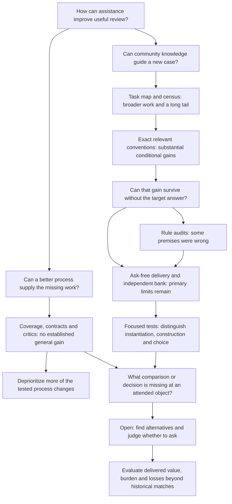

# Rebuilding the update around the research argument

Working content proposal, 3 November 2026. Based on the
[September–October experiment map](experiment-map.md), rather than the selection in either
meeting draft. This document chooses an argument and supporting cases; it does not impose
a duration or allocate one experiment to each slide. The existing decks remain references.

## The central question and the account of progress

**How can we make an AI useful at reviewing a formal-mathematics contribution, beyond checking
that its proofs work?**

The original framing is a useful starting point: generation searches for a contribution
that realizes a purpose; review starts with a proposed contribution and asks what should
change. The standard is partly implicit, depends on the library and context, and can favor
more than one implementation. A working alternative is evidence for a possible revision;
it does not by itself establish the reason to prefer it or the value of asking for it.

The account of progress I would present is:

> We began with a process hypothesis: understanding and structuring review work should let
> us improve on a single reviewer. Testing that hypothesis exposed limits in our task
> description, our baseline, and our diagnosis of misses. A broader corpus gave us a better
> description of what review asks for. Supplying the relevant convention then produced a
> substantial conditional improvement. But attempts to obtain that benefit in ordinary
> review have not established reliable transfer. The follow-ups show why one explanation
> is insufficient: sometimes our rule was wrong, sometimes the reviewer never posed the
> relevant comparison, sometimes its construction was wrong, and sometimes it built a
> working alternative and still declined it. The next research question is how to improve
> those comparisons and requests, with a credible measure of usefulness.

This is an argument about what the programme has learned, rather than a claim that a new
reviewing system has already beaten the strong solo baseline. It also retains the positive
results: a richer task description, useful operations, conditional knowledge effects,
and observable proposal transmission. The negative results change which explanation or
intervention is worth pursuing; they are not interchangeable failures.

## The bird's-eye view

The audience should be able to recover this map before we zoom into any case.

| General question | What the experiments let us say | What remains open |
|---|---|---|
| **Can process structure improve review?** | More scheduling, verdicts and critics did not establish a reliable advantage. A description of work can be useful without its proposed execution improving review. | Which operations add something a capable solo reviewer does not already do? |
| **What standard is the reviewer applying?** | Review covers more than the familiar dev PRs; conventions are numerous and contextual. Some operational rules we wrote were invalid. | How can valid scope, competing reasons and changes in practice be recovered? |
| **Can project knowledge change the review?** | Yes under target-assisted relevance; ordinary transfer has been much weaker and less reliable. | How can the reviewer find and instantiate the right comparison without the answer? |
| **What happens once an alternative is available?** | Some supplied or focused alternatives are constructed but not requested. Others still fail technically or concern the wrong action. | What evidence should change the comparison and the decision to ask? |
| **What counts as a better review?** | Historical agreement and feasible edits measure useful pieces, but neither measures overall value. Extra proposals include promising additions and concrete errors. | How do we assess useful additions, unnecessary work and lost ordinary findings? |

The presentation need not visit these rows once each. The standard and evaluation questions
recur while interpreting the intervention results. In particular, a later scope audit can
qualify an earlier knowledge result where it helps explain the argument, without recounting
every intervening experiment.

The following is a map of research reasoning, not execution order. The arrows mean
"this result makes this narrower question worth asking"; they do not assert a causal
effect across experiments or make every branch depend on a single predecessor.



The task-characterization branch remains a result in its own right. The source and
reconstruction studies also bear on the comparison node, even though they are not
drawn as extra sequential steps here. Their detailed links are in the experiment map.

## 1. Start with a concrete review decision, then state the task

Use one example from the original framing: a proof can be replaced by a shorter proof,
or a theorem specialized to a number can be stated with a parameter. Both versions may
compile. The question is why a maintainer would ask the author to make the change.

That establishes the distinction we need throughout:

| Judgment | What would establish it? | What it does not establish |
|---|---|---|
| **Feasibility** | A technically valid alternative preserving the relevant purpose | That it improves the contribution |
| **Comparative reason** | A benefit relative to the submitted form, including competing consequences | That asking is worth the cost in this review |
| **Request value** | A justified question, suggestion or revision request | That the recorded historical reviewer would necessarily make the same choice |

Keep the original mathematical formulation available, using the later qualifications:
`S(C,p)` is the solution set, `A(x)` the acceptable subset, `≽x` contextual preference, and
`Jx(r,δ)` the justification for asking. Compilation checks only part of `S`. An ordering does
not define acceptance, and acceptance does not exclude useful improvements. These are
distinctions among claims, not a proposed sequence of agents or a claim about cognitive stages.

This lets the audience understand why a compiled edit, a reconstructed solution, and a
historical match can disagree without treating one of the measurements as pointless.

**Place previous work here by the question it answers.** APE-Bench concerns constructing a
contribution. MathlibPR studies merge readiness. ProofJudge compares supplied versions;
that is useful for the preference part, while discovery remains part of our problem.
SWR-Bench and SWE-PRBench share the review-generation task. AutoCommenter demonstrates
learning and delivering practices with calibrated scope; Tricorder/Infer demonstrate
checkable analysis in a review workflow. RovoDev's actionability work bears on the distinction
between a true comment and one worth making. These comparisons motivate subquestions;
they do not prove that our task is unique or that their mechanisms transfer to Mathlib.

Sources: [original framing](../supervisor_update_2026-10/slides.md),
[qualified theoretical account](../docs/research/review-knowledge-transfer-grounding-2026-10-23.md),
[saved related-work survey](../docs/research/code-review-systems-survey-2026-09.md),
[mechanism comparison](../.claude/worktrees/review-systems-mechanisms/docs/research/review-systems-mechanisms-comparison-2026-10-22.md).

## 2. The process hypothesis: what should a harness add to one reviewer?

The first substantive question is the original thesis: understand review, then decompose it.
There were two different uncertainties under that heading:

- **Did we describe the work correctly?** Perhaps the roster omitted the questions that matter.
- **Would executing it differently help?** Perhaps routing, silence or the submission contract
  prevented competent local reviewers from contributing.

The studies of review work and the harness interventions answer different sides of that split.
Show them together so the audience can see why a better task map did not automatically earn
a larger multi-agent implementation.

The large corpus corrected our view of the task. Four of seven claims from the small audit
did not replicate. Statement/API design and PR-level review were important gaps, with more
PR-level asks among AI-generated contributions. The facet work made the reference and the
warrant explicit: what is this code being compared with, and what would settle the question?
Its experimental brief reached some consequential design questions while losing local ones.

In parallel, the harness comparisons limited the simple process explanations. The lead plus
specialists was costlier and did not establish superiority over solo. Unpruned fanout did
not solve the deficit. Forcing output recovered some asks but flooded the control; requiring
verdicts did not recover most missing changes. Ledger and critic studies subsequently gave
the same warning on a stronger model: making every cell explicit is not enough.

**The progress to communicate:** we learned both more about the work and less confidence in
generic process changes. The problem was often the question answered at a declaration that
had already been examined. That is more specific than saying the model did not review enough.

**Possible zoom: `ConvexSpace`, not a roster diagram.** The facet reviewer considered a
monad-algebra style definition using `FiniteProbability`; the ordinary brief found local
issues on the same class. This shows what a change in the question can reveal. Immediately
zoom back out: the same intervention lost seven local asks and did not validate the whole
brief. One attractive example is not the experiment's overall answer.

Keep the model/reasoning/harness investigations as a control on this account. GPT reasoning
and continuity repairs mattered operationally; they did not erase the gap. A stronger solo
route remained the standard to improve on. Do not spend the presentation on a model leaderboard
or imply that early weak-model results rule out every decomposition of a capable reviewer.

Evidence: [E02–E06](experiment-map.md#e02), [E08–E10](experiment-map.md#e08).

## 3. The knowledge hypothesis: what does the community know that the reviewer misses?

Return to the residuals. Looking at a declaration did not mean the reviewer considered the
right mechanism, name, proof or design. This motivated asking what knowledge governs these
choices, rather than continuing to increase coverage.

The census is an important result here. It provides a broad empirical picture: hundreds of
conventions, a long tail, and entries describing most asks on a separate small panel. The
older naming and catalogue work also showed why token prevalence or written guidance alone
does not determine the standard. Existing forms can coexist during a migration; the most
common form need not be the requested one.

Then give the **conditional positive** clearly, before its limitations: with entries selected
from the target asks, Opus's in-census recovery moved from roughly 46–49% to 74%. Other models
also improved. The stage-W GPT result shows that the use and filing contract could change
recovery even with the exact knowledge held fixed.

The question this answers is "Can this information change a review?" It leaves the more
important system question: "Can we supply and use it without knowing the desired request?"

The selected-from-diff, guarded-rule and AP studies did not establish reliable transfer.
Some had an apparent gain on the motivating cases that did not carry to other panels.
The known-place ladder recovered much of the change with the sentence alone; extra examples
did not supply a general fix. Detectors made concrete facts available but covered little
of the long tail. These results are informative constraints on a knowledge programme.

**The progress to communicate:** knowledge is a demonstrated conditional lever, while a
method for turning it into better ordinary review remains unestablished. This is a useful
gap to investigate, not a reason to call the resource either a solution or a complete failure.

Evidence: [E07](experiment-map.md#e07), [E12–E16](experiment-map.md#e12).

## 4. Why transfer is difficult: separate the rule, the comparison and the request

This is the central investigative section. Organize the follow-ups by the claim they test,
using the later evidence to qualify earlier interpretations. The audience does not need
the order in which the probes were launched.

### 4a. Are we supplying a valid rule in the first place?

The low historical ask rate at flagged places initially suggested a gap between applicability
and demand. The audit changed that account. For namespace placement, the detector often
preferred the wrong namespace under the reconstructed rule. For dot notation, many checked
departures were real and still survived without a request. Prime-name calibration failed.

**Zoom: two different meanings of an unasked flag.** Show namespace and dot notation together:
85–97% of selected namespace survivors were non-departures; 12–13 of sixteen checked
dot-notation survivors were departures. These are distinct samples with distinct denominators.
The purpose of the comparison is to show why we cannot use one enforcement rate to explain both.

This changes a research decision: the earlier dismissal of richer knowledge could not stand
merely on the assumption that the supplied rule was sound. Independently acquiring and checking
scope became a reasonable bounded test again. It did not establish that longer notes would help.

The practice and stated-grounds studies impose another limit. Form rules may be broader than
maintainers' own practice, and a nearby comment does not prove that a departure was considered.
Stated reasons were mixed evidence for the proposed reasoning-over-taste account. We cannot
infer a complete community decision rule from silence, survival or a plausible rationale.

Evidence: [E17–E18](experiment-map.md#e17).

### 4b. Does valid knowledge make the reviewer pose the relevant comparison?

The compact/full-bank study is the cleanest whole-review result to put here. It used six notes
acquired from independent earlier sources; all treatment PRs received the same frozen bank.
This avoids selecting the applicable note from each target's answer, while retaining the
developmental limitation that the known targets helped steer source selection.

Across 54 final reviews, neither treatment recovered any of the three primary concerns in
any repetition. Notes arrived, and the primary requests were absent before finalization too.
Some reviewers considered a nearby question: the hypothesis namespace rather than the
conclusion namespace, registration rather than the proof simplification, or a different
dimension of generality.

This answers a specific investment question: the bank did not earn advancement under its
rule. The primary outcome should come before broader means or attractive extra suggestions.
The 41.1% full-bank versus 35.6% ordinary historical recovery remains a descriptive secondary
result, with overall usefulness unjudged.

**What follows from the miss:** isolate whether the reviewer can construct and assess the
alternative when the declaration and concern are supplied. That motivates the focused probe;
it is not just another attempt to get a higher whole-PR number.

Evidence: [E23–E24](experiment-map.md#e23).

### 4c. What remains once the alternative is in view?

Bring two strands of the record together here, although they were run at different times.
One supplied library sources and independent designs; the other supplied a focused question.
They expose related distinctions, with different limits.

**Zoom: `to_fun` and handwritten theorem families.** The library contains a mechanism for
generating function-form twins. Supplying sources and correspondence made all six assisted
Opus sessions connect it to the submitted family in the repaired-search diagnostic; only
one requested the change. Some attempts failed through missing imports or incorrect setup.
Other objections involved local siblings and adoption. Later checking also found a real
client-interface difference in generated `sum`/`prod` forms.

The example separates discovering a mechanism, constructing it correctly, preserving the
interface and choosing to adopt it. A directive to prefer the library mechanism would skip
the question the evidence is supposed to answer. The grounds reading supplied costs and
conditional reasons, not a universal priority rule.

**Zoom: generalizing the constant in #33421.** The focused sessions replace a fixed factor
with a parameter while retaining the original lemma as a special case. Schematically:

```text
2 * fract x = 1   →   c * fract x = 1, with 1 < c
```

The full theorem and the six candidates differ; this is an illustration of the change.
All six target sessions constructed checked generalizations. Without the note, two of
three suggested generalizing; with the note, none did. One session compiled essentially
the historical form and declined because no other constant was called for.

The observation is not that generalization is solved, or that the note makes decisions
worse in general. It is that on this case a feasible alternative and a request decision
can be inspected separately. The right follow-up concerns the benefit, API cost, scope and
whether the advice should be optional, rather than simply requesting more compilation.

Other focused cases prevent making this a universal diagnosis. Namespace construction
changed with the note. The automation prompt tested registration rather than the intended
proof action. Some `to_fun` decisions rested on a failed construction. Different misses
still require different evidence.

Evidence: [E19–E21](experiment-map.md#e19), [E24](experiment-map.md#e24).

## 5. The boundary of the current claim: what would count as better review?

The evaluation question belongs inside this story because it changes what we can conclude
from both a negative historical score and a positive compiled example.

Independent sketches did transmit some concrete proposals into final reviews, without
establishing the registered multi-PR historical gain. The preparation pilot likewise found
more sources without recovering more asks, with an environmental limitation on one PR.
These results downgrade those particular intervention routes; they do not prove all their
extra suggestions lack value.

Use one **pair of contrasting additions** rather than a list. The normalizer-hypothesis
generalization on #43167 was checked and proposed in sketch-assisted review: a real candidate
for useful additional API. In another case a compiled proposal was called a hypothesis
weakening even though it strengthened the assumptions. This demonstrates that technical
feasibility, a valid comparison and request value are different checks.

The bank's `dslope` proposal is another possible illustration: a compiled proof can avoid
imports without matching a recorded request. Its value is an open assessment, not an
alternative primary success metric. Choose it instead of the normalizer pair if the team
needs a simpler discussion case; the normalizer pair connects more of the research record.

Explain the practical limit plainly. We have historical matching and some technical and
selected-case readings. The saved usefulness panels do not yet establish the overall value
of the bank or preparation interventions. The additions triage recommended releasing effort
from costly reconstruction while keeping value labels uncollected; it did not settle the
larger comparison question. Some suggestions were also lost after submission, which is a
delivery problem rather than evidence that the model never found them.

Evidence: [E20](experiment-map.md#e20), [E22–E25](experiment-map.md#e22).

## 6. End on the live research decisions

The conclusion is a set of better specified questions, with different evidence requirements.
It should give the team a chance to disagree about the next investment.

| Open question | Why it is live | What an answer would need |
|---|---|---|
| **How does a reviewer find a consequential alternative at acceptable-looking code?** | Whole reviews miss comparisons that focused sessions can construct; other constructions still fail | Final-review gains on independent PRs, with ordinary findings and resource use accounted for |
| **Can independent evidence improve the decision once a checked alternative exists?** | Some focused and source-assisted sessions construct or recognize an alternative and decline it | Cases with explicit reasons favoring both revision and retention; preference, optional advice and required revision separated |
| **What representation of a convention preserves its limits?** | Wrong scope undermined earlier experiments; the independent bank still failed its primary test | Accurate independent application, competing consequences and uncertainty, followed by useful review rather than source-audit success alone |
| **How can we establish value beyond historical matching?** | Some extra proposals may be useful; others are wrong or burdensome | A credible independent assessment of the actual delivered suggestions, including losses and contrary cases |

The bounded supplied-candidate diagnostic in the 27 October assessment is a **proposal**
addressing the second row. It is attractive because it fixes one uncertainty while examining
another. It does not resolve autonomous discovery or justify another whole-PR architecture.
The team could reasonably prioritize the first or fourth row instead.

There is also a theoretical question to discuss: can the operative standard be recovered as
conditional reasons sufficiently well to guide new reviews, or do contextual preferences
require another form of learning or judgment? The corpus and stated-grounds studies motivate
this question; they do not settle it by declaring taste small or rules complete.

## What belongs at each level of the eventual presentation

The hierarchy should come from the argument above, not from labels added to a linear run list.

| Content level | What the audience should retain | Evidence to select | Suitable zoom |
|---|---|---|---|
| Task and theoretical question | A justified request requires more than a working revision | Original formulation, qualified distinctions and related tasks | One valid improvement whose value is debatable |
| Process and baseline | Better coverage and a better work map did not automatically create a better reviewer | Lead/solo, forced/unified contract, large task audit, strong solo controls | `ConvexSpace` design gain with the local losses kept visible |
| Conditional knowledge result | Relevant knowledge can change requests; transferring it is unresolved | Census, exact supply, ask-free non-transfer | One exact-supply comparison, not the entire model table |
| Explanation of the transfer gap | Rule validity, instantiation, construction and choice are distinct uncertainties | Validity audit, independent bank, focused results, source diagnostics | Namespace versus dot flags; `to_fun`; constant generalization |
| Current boundary and discussion | We need useful decisions on new cases and a credible value measure | Reconstruction additions, failed advancement rules, pending panels | Normalizer versus false weakening, or the unjudged `dslope` proposal |

This permits zooming in and back out. A case should be introduced with the question it makes
concrete, followed by the comparison that bears on it, then returned to the programme-level
consequence. The text at this stage is content material for that explanation, not slide copy.

### Experiments to summarize rather than present individually

- Reasoning/provider/cost/tool repairs establish the baseline and interpretation. Include
  only the defect needed to understand the evidence being shown.
- Fanout, forcing, verdicts, replays, ledgers and critics form a family testing process-only
  explanations. Present the discriminating contrasts; retain all details in the map.
- AP variants, the ladder, per-place tests, shortlists and the dossier review constrain
  knowledge delivery. Their different units should not become one combined score table.
- Detectors and mechanical operations show useful narrow capabilities plus coverage or
  burden limits. They do not need separate main-story chapters.
- The preparation and reconstruction interventions belong where they test a claim about
  evidence or alternatives. They need not be neighboring sections because of their dates.

### What this narrative must not imply

It must not imply that decomposition is impossible, that every miss is withholding, that
the relevant convention is always correct, that exact supply demonstrates transfer, that
a failed primary test settles overall usefulness, or that one working generalization solves
candidate discovery. It also must not hide corrected interpretations behind the older,
cleaner story. Those changes of mind are part of the progress the update should explain.

## Why this route, and the alternatives

I would use **questions and changes in belief** as the main route, with the cases nested
inside it. It lets us move the validity correction beside the applicability claim and bring
the source and focused diagnostics together, even though their execution dates differ.
The broader programme remains visible when a small experiment answers only a narrow question.

A route built entirely around #33421 would be easier to follow locally, but it would poorly
represent task characterization, whole-PR purpose and the library/interface tradeoff. A
route organized as task/theory, then all experiments, then discussion would preserve headings
while leaving the audience to reconstruct the argument. A chronological route would make
research effort visible but repeatedly change units and models before explaining the result.

The proposed route retains the useful concrete thread without making it carry the whole
project. Selection and compression can follow once this account of the content is right.
