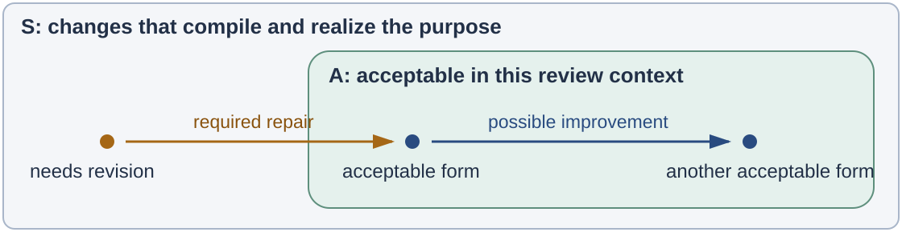

<!-- _class: lead -->
<!-- _paginate: false -->
<!-- _footer: "" -->

# Reviewing Mathlib

## The research questions, this month's experiments, and what follows

Yousef Alhessi · 4 November 2026

<div class="source">From a contribution that compiles to a change worth requesting.</div>

<!--
About 15 seconds. The project concerns reviewing formal-mathematics contributions,
including the eventual AI-generated-PR setting. This month's empirical focus is
convention knowledge; that is one route into the broader research problem.
This version restores the theoretical frame and prior-work positioning to the main
talk, with explicit separation of research questions, bounded studies and discussion.
The reference decks and first prototype are preserved.
-->

---

<!-- _header: "THE STRUCTURE OF THIS UPDATE" -->

# Four parts, at two levels

<div class="grid">
<div class="card"><h2>1 · Framing and previous work</h2><p>The task, its distinctions, and where this project fits.</p></div>
<div class="card"><h2>2 · Research questions</h2><p>The broader questions we want to answer.</p></div>
<div class="card green"><h2>3 · Experiments this month</h2><p>Three bounded studies bearing on those questions.</p></div>
<div class="card"><h2>4 · Open questions</h2><p>What the evidence leaves us to discuss.</p></div>
</div>

<!--
About 30 seconds. Explicitly distinguish the programme from the experiments.
The research questions are not renamed individual runs. The experiments provide
partial evidence for or against narrower hypotheses; then we return to the research
questions. Main route: slides 1–18, followed by six backups.
-->

---

<!-- _header: "1 · FRAMING AND PREVIOUS WORK" -->

# What does review add to proof engineering?

<div class="cards">
<div class="card plain"><h2>APE-Bench: construct</h2><p>Given a library and a purpose, produce a change that realizes it.</p></div>
<div class="card"><h2>Review: critique</h2><p>Given a proposed change, identify the further changes worth requesting.</p></div>
</div>

The kernel checks stated types under the environment's assumptions. Intent, interface quality and the value of a revision need other evidence.

<div class="callout">Several technically valid solutions can serve the same purpose.</div>

<!--
About 1 minute. Introduce C, the library state; p, the contribution purpose; and δ,
the submitted diff. In APE-Bench the task specification is supplied. In review,
the PR is already proposed, while much of the community's standard is implicit.
Review can question the purpose or scope too, and p may be incomplete or disputed.

Do not equate compilation with all mathematical or semantic correctness: axioms,
the intended statement and realization of purpose remain separate. Not every
historical reviewed head builds. This theoretical distinction does not depend on
the universal assertion that every PR in the corpus already compiled.

Sources: original supervisor formulation; docs/project-research-overview.md,
grounding; docs/research/review-knowledge-transfer-grounding-2026-10-23.md §1.
-->

---

<!-- _header: "1 · THE TASK MODEL" -->

# Validity, acceptability and preference differ

<div class="space">



</div>

<div class="formula">

$A(x)\subseteq S(C,p)$ &nbsp; · &nbsp; $\delta'\succeq_x\delta$ compares viable alternatives

</div>

<div class="callout">An acceptable contribution may still admit a worthwhile improvement.</div>

<div class="source">Context x includes the library, contribution purpose, time and review situation.</div>

<!--
About 1 minute 15 seconds. Define S(C,p) as changes that compile and realize p;
A(x) as the acceptable subset, where x=(C,p,t,k). The picture is schematic, not
a measured geometry or a total quality ranking. A and comparative preference ≽x
are separate contextual judgments: the ordering alone does not determine a threshold.
Preferences may be incomplete and depend on area, reviewer, time and context.

The original four-PR examples distinguish a vacuous contribution from an API or
proof improvement. We do not need the full table here: the point is that asking
for a better proof is not necessarily declaring the contribution unmergeable.
The arrow within A shows a possible preference; it does not assert that every
technically different alternative is better or worth requesting.

Sources: theoretical grounding §§1,3; maintained overview grounding and requests.
-->

---

<!-- _header: "1 · FROM PREFERENCE TO A REVIEW REQUEST" -->

# When does an alternative justify a request?

<div class="cards">
<div class="card plain"><h2>Feasibility</h2><p><i>δ′ ∈ S(C,p)</i></p><p>The alternative works.</p></div>
<div class="card plain"><h2>Preference</h2><p><i>δ′ ≽<sub>x</sub> δ</i></p><p>There is a reason to prefer it.</p></div>
<div class="card"><h2>Request value</h2><p><i>J<sub>x</sub>(r,δ)</i></p><p>Asking for r is justified.</p></div>
</div>

A reviewer emits requests **D**: conditions on revisions, questions or suggestions. A checked patch can witness a repair; several repairs may satisfy the same request.

<div class="callout">A recorded review shows one set of choices, not the whole community standard.</div>

<!--
About 1 minute 15 seconds. These are distinct judgments, not a claim that maintainers
reason in three sequential stages or that three agents are needed. J is notation
from the existing theoretical-grounding note, naming request-worthiness rather than
an implemented score. It can depend on benefit, interface cost, author burden and
the rest of the review. An optional suggestion can be useful without being required.

For concrete changes, the original test-on-revisions model separates the request
from a witness patch. Questions and advisory comments need a broader interpretation.
Do not repeat the original strict completeness condition as an evaluated guarantee:
historical matching does not measure full soundness/completeness against A or ≽.
Merged survival does not reveal whether a reviewer considered a departure.

Source: docs/research/review-knowledge-transfer-grounding-2026-10-23.md §§1,3.
This theoretical frame will matter when the focused sessions construct alternatives
but decline to request them, and when useful-looking findings miss historical gold.
-->

---

<!-- _header: "1 · POSITIONING THE TASK" -->

# Related work asks several neighboring questions

| Work | Task | Question for this project |
|---|---|---|
| **MathlibPR** | Judge merge readiness | Which particular request? |
| **ProofJudge** | Compare supplied versions | How is the alternative found? |
| **SWR-Bench / SWE-PRBench** | Generate review feedback | Shared task; Mathlib-specific tests |
| **AutoCommenter** | Apply learned practices | Scope and transfer from sparse sources |

<div class="callout">Our target includes discovering the relevant alternative and justifying a useful request in Mathlib.</div>

<!--
About 1 minute. This is positioning, not a claim that review generation is unique
to our project. SWR-Bench and SWE-PRBench share that broader task. MathlibPR's PR-level
decision does not provide a particular concern and repair. ProofJudge's supplied
pairs can test comparative preference while leaving alternative discovery open.
AutoCommenter predicts a location and best-practice URL; Tricorder hosts analyses.

The contribution must be an empirical characterization or a demonstrated capability
beyond the mere presence of tools, retrieval, rules or multiple agents. c-CRAB and
resolution-based studies address response/actionability and are also relevant to
evaluation. The reference includes them; no unsupported numerical cross-paper
comparison is made on this slide.

Sources: saved survey and maintained overview literature section. Papers and full
identifiers are in backup. This is the local saved primary-source reading, not a
new systematic literature search or refreshed product-capability comparison.
-->

---

<!-- _header: "1 · COMPARING MECHANISMS" -->

# What can we take from previous systems?

<div class="cards">
<div class="card"><h2>Known practices</h2><p>AutoCommenter links a rule to a location and calibrates its delivery.</p></div>
<div class="card"><h2>Technical checks</h2><p>Tricorder and Infer bring checkable analyses into the review workflow.</p></div>
<div class="card"><h2>Comment selection</h2><p>RovoDev uses outcome-labeled data to train an actionability gate.</p></div>
</div>

<div class="callout">Which mechanisms address our observed Mathlib failures—and what evidence would show that they help?</div>

<!--
About 1 minute. These are established mechanisms, not a proposed architecture.
Their data and operational settings differ from ours. AutoCommenter's learned
prediction and per-URL calibration are not equivalent to appending guidelines.
RovoDev's factual judge had little measured effect while its learned actionability
gate helped on its population; subsequent resolution is not maintainer ground
truth for every unmatched finding. Tricorder also treats unwanted true reports as
an effective false-positive problem.

Our existing tools support source search, edit checking and retained experiment
records. Those properties help test interventions; they do not supply the missing
comparison or request judgment. Which component is useful depends on the loss
stage. The earlier solo/decomposition baseline remains in the detailed report.

Sources: docs/research/code-review-systems-survey-2026-09.md;
review-systems-mechanisms@ce26a2b4:docs/research/review-systems-mechanisms-comparison-2026-10-22.md.
-->

---

<!-- _class: questions -->
<!-- _header: "2 · THE PROJECT-LEVEL RESEARCH QUESTIONS" -->

# Three questions organize the programme

<div class="card"><h2>RQ1 · What standard is review applying?</h2><p>Principles, scoped conventions, exceptions and changing practice.</p></div>
<div class="card" style="margin-top: 16px"><h2>RQ2 · How can assistance improve solo review?</h2><p>Finding alternatives, comparing them, and deciding what to request.</p></div>
<div class="card" style="margin-top: 16px"><h2>RQ3 · What establishes useful review?</h2><p>Historical agreement, extra suggestions, errors and author burden.</p></div>

<!--
About 1 minute. These are the programme questions. They are intentionally broader
than the tests that follow. This month's approach used convention knowledge as one
route into RQ1/RQ2. It does not exhaust the possible ways to improve a solo reviewer.

The tested hypotheses were that our convention entries had usable scope, and that
independent notes would prompt better comparisons and requests. RQ3 limits how to
interpret historical matching and the extra suggestions. The theory separates A,
≽ and J rather than assuming that a single label answers all three questions.

Explicit transition: we now move from the research programme to this month's
experiments. Each named study tests a narrower claim.
-->

---

<!-- _class: evidence -->
<!-- _header: "3 · THIS MONTH'S EXPERIMENTS" -->

# Three studies, each testing a narrower claim

| Study | What it tests | Bears on |
|---|---|---|
| **A · Rule validity** | Did our convention flags identify real departures? | RQ1 |
| **B · Knowledge transfer** | Do independent notes improve ordinary review? | RQ2 |
| **C · Focused diagnosis** | Does a supplied concern expose the missing alternative? | RQ2 |

<div class="callout">These are development studies. Their outcomes constrain the tested interventions.</div>

<!--
About 30 seconds. The first corrects an interpretation from the earlier work.
The second is the main whole-review comparison. The third follows up its primary
misses. “A/B/C” are presentation labels, not new experiment identities; source IDs
and snapshots remain E3/E4, E8/E9 and E10/E11 in evidence.md. Do not confuse Study B
with the original knowledge-bank arm labels A/B/C in the raw artifacts.

The reference retains the conditional-preparation pilot and earlier instruction
positives. Their effects are not pooled with this bank or focused comparison.
-->

---

<!-- _class: evidence -->
<!-- _header: "3 · STUDY A · RULE VALIDITY · RQ1" -->

# Did our flags identify real departures?

<div class="kind">Method</div>

Follow flagged places to merge; check the rule against code, scope and known fixes.

<div class="cards">
<div class="card plain"><h2>Namespace placement</h2><p><strong>85–97%</strong> of selected unasked survivors were not departures.</p></div>
<div class="card plain"><h2>Dot notation</h2><p><strong>12–13 of 16</strong> checked unasked survivors were genuine departures.</p></div>
</div>

<div class="callout">RQ1: the single “5% of applicable places” interpretation mixed different phenomena.</div>

<!--
About 1 minute 30 seconds. The corrected namespace estimate is 85–97% non-departures
in the relevant selected unasked-survivor stratum, not a population-wide rule error
rate. The detector often preferred the conclusion namespace while the reconstructed
rule favored the main hypothesis. For dot calls, 12–13/16 checked survivors were
genuine departures. Re-derived prime-name text still failed calibration, 4/6 known
fixed departures for both readers, below the 5/6 bar.

The six-rule practice follow-up on 973 PRs showed some texts broader than anyone's
practice, and rewrites near comments did not establish action on the specific rule.
That narrow form-rule sample does not settle all substantive conventions. Survival
does not tell us whether a valid rule was noticed and rejected. This investigation
motivates calibrated scope; it does not prove that more detailed notes improve review.
Evidence: E3–E4 in evidence.md, including final adversarial corrections.
-->

---

<!-- _class: evidence -->
<!-- _header: "3 · STUDY B · KNOWLEDGE TRANSFER · RQ2" -->

# Can independent notes improve whole-PR review?

<div class="kind">Setup</div>

Build **six checked notes from earlier sources**. Give the same bank to every PR.

<div class="common">Same PRs · same reviewer · same tools</div>

<div class="cards">
<div class="card plain"><h2>Ordinary</h2><p>No extra notes</p></div>
<div class="card"><h2>Compact</h2><p>Short account</p></div>
<div class="card"><h2>Full</h2><p>Reasons and conditions</p></div>
</div>

<div class="source">6 PRs × 3 conditions × 3 repetitions = 54 final reviews · Opus 5.5</div>

<!--
About 1 minute 15 seconds. Motivation from the previous check-in: exact convention
supply helped Opus, about .46–.49 to .74 in-census reach, but entries had been chosen
using target asks. Ask-free selection did not reliably transfer. The new test asks
whether independently acquired, source-checked notes improve an ordinary reviewer.

Compact and full notes use the same eligible sources. All six go to every treatment
PR, without a target-specific assertion of applicability. There were three primary
opportunities and three contrary targets. Acquisition respected target exclusion
and date gates, with reserved checks, bounded repairs and explicit uncertainty.
Source selection was steered by already familiar targets: developmental evidence,
not automatic discovery or fresh generalization. Only generality had both a positive
and contrary whole-PR target under the same entry.

The prediction was stable improvement on at least two primary concerns, with quality
guards. The next slide reports that primary observation first.
Evidence: E1 for earlier motivation; E8–E9 for this comparison.
-->

---

<!-- _class: evidence -->
<!-- _header: "3 · STUDY B · KNOWLEDGE TRANSFER · RQ2" -->

# Neither version recovered the target concerns

<div class="kind">Result · three primary concerns</div>

<div class="cards">
<div class="card plain"><h2>Ordinary</h2><div class="metric">0/3</div></div>
<div class="card plain"><h2>Compact</h2><div class="metric">0/3</div></div>
<div class="card plain"><h2>Full</h2><div class="metric">0/3</div></div>
</div>

Namespace choice, proof automation and constant generalization were absent in every repetition.

<div class="callout">RQ2: this bank failed its advancement rule. The broader assistance question remains open.</div>

<div class="source">Full notes recovered some other asks; overall usefulness is still unjudged.</div>

<!--
About 1 minute 15 seconds. Counts are distinct primary concerns recovered in each
condition, over all repetitions, not a 3-PR recall estimate with independent trials.
Each primary PR has nine reviews across conditions. The automation concern spans
two parallel raw asks. None is fully reached, so the count is zero under either
any-repetition or stable-recovery reading. The broader 30-ask means are in backup.

All treatment notes arrived. These requests are absent from submitted and finalized
findings, so anchoring loss is not the explanation. The required gains on two
primary concerns cannot be met. This does not establish that knowledge cannot help,
that all the other findings are wrong, or that the full arm had no changes.
The 491-item usefulness panel remains unlabeled. Both saved matchers agree on the
primary misses. Reference bank-arm labels are A/B/C, distinct from our study labels.
Evidence: E8 in evidence.md.
-->

---

<!-- _class: evidence -->
<!-- _header: "3 · STUDY C · FOCUSED DIAGNOSIS · RQ2" -->

# Would a narrower question expose the alternative?

<div class="kind">Setup</div>

<div class="flow">
<div class="card plain"><h2>Whole PR</h2><p>“Review this change.”</p></div>
<div class="arrow">→</div>
<div class="card"><h2>Declaration + concern</h2><p>“Could this theorem be more general?”</p></div>
</div>

Compare **no note** with **the same relevant note**.

<div class="source">72 sessions across three selected cases, including sibling checks. The concern is now supplied.</div>

<!--
About 1 minute. These are illustrative task descriptions, not literal transcript
quotations. The focused follow-up examines the three primary misses. 24 sessions
per case include target and sibling declarations, with three repetitions per cell.

This changes the task: declaration isolation, supplied concern, resource allocation
and retrieval scope also differ. It is a conditional diagnostic, not a causal
estimate of focus alone or autonomous review improvement. We ask two observable
questions separately: did the intended alternative appear, and did it become a request?
Start with generality; the other cases and their different limits are in backup.
Evidence: E10–E11 in evidence.md.
-->

---

<!-- _class: evidence -->
<!-- _header: "3 · STUDY C · FOCUSED DIAGNOSIS · RQ2" -->

# Generality separated construction from choice

<div class="kind">Worked result · PR #33421</div>

<div class="flow">
<div class="example">2 * fract x = 1</div>
<div class="arrow">→</div>
<div class="example">c * fract x = 1<br><span class="label">with 1 &lt; c</span></div>
</div>

All **six** sessions compiled a generalization and kept the special case.

> “Nothing in the PR or the library calls for a constant other than 2.”

<div class="cards">
<div class="card plain"><h2>Without the note</h2><p><strong>2/3</strong> suggested generalizing</p></div>
<div class="card"><h2>With the note</h2><p><strong>0/3</strong> suggested generalizing</p></div>
</div>

<div class="source">One selected PR; one candidate shown. The six generalizations differed.</div>

<!--
About 2 minutes. Explain the mathematics first: replace a numeric constant with a
parameter while retaining the specialized lemma used by round as a corollary.
The displayed expressions omit the full equivalence and context. This c>1 form
was compiled by Efract2; other sessions generalized different domains/constants.
All six have saved successful edit checks, not six identical historical repairs.

The historical maintainer asked for generalization. The nine whole reviews had
not proposed this parameterization. Under the supplied concern all six build one.
No-note answers deliver two generality requests: one full and one partial historical
match. Note answers deliver none. The quote is from Efract2 with initial capitalization
changed; it compiled essentially the historical form and declined it.

The note favored generalizing proof artifacts, and the answers treated this constant
as meaningful to the task. A no-note answer also cited lack of another caller.
Three samples per condition on one known target do not establish a general causal
claim that notes worsen choices. They expose a concrete distinction in the theory:
technical feasibility did not settle preference or request justification.
Evidence: E10 generality answers; E11 independent assessment.
-->

---

<!-- _class: questions -->
<!-- _header: "RETURN TO THE RESEARCH QUESTIONS · WHAT DID THE STUDIES CHANGE?" -->

# Evidence gained, questions still open

<div class="card"><h2>RQ1 · The standard</h2><p>Some flags were invalid. Survival did not identify a review decision.</p></div>
<div class="card" style="margin-top: 16px"><h2>RQ2 · Assistance</h2><p>The bank failed its target test. Some focused alternatives were constructed, then declined.</p></div>
<div class="card" style="margin-top: 16px"><h2>RQ3 · Usefulness</h2><p>Historical recovery is measured; overall usefulness remains unjudged.</p></div>

<!--
About 45 seconds. This explicitly returns from the three studies to the programme.
Do not promote a study result to a universal claim about conventions or harnesses.
The scope correction, conditional generation result and unfinished usefulness
assessment identify different unresolved questions. The record does not establish
that taste is a small residual or that a longer resource would supply a validated
decision rule. We now move to open questions, not another experiment report.
-->

---

<!-- _class: discussion -->
<!-- _header: "4 · OPEN QUESTION · PREFERENCE AND REQUEST VALUE · RQ2" -->

# When is a better alternative worth requesting?

The theory separates **preferring an implementation** from **justifying a request**.

<div class="flow">
<div class="card plain"><h2>Hold fixed</h2><p>Current code + checked alternative</p></div>
<div class="arrow">→</div>
<div class="card"><h2>Ask separately</h2><p>Keep · optional suggestion · required revision</p></div>
</div>

<div class="callout">Proposed next test: independent cases favoring both change and retention.</div>

<div class="source">This isolates the decision. Autonomous discovery of alternatives remains unresolved.</div>

<!--
About 1 minute. This is a proposed diagnostic, not an agreed or registered study.
The theory's J judgment is not automatically determined by pairwise preference.
A cheap proof improvement might still have API, inference, scope or author costs;
absence of a caller is not by itself proof of no value. Optional versus blocking
requests should be separately observable.

First inspect the six existing generality answers and checked consequences. Then
find independent explicit decisions about feasible alternatives with meaningful
competing costs. Do not use silence as a retention label or encode the familiar
target's historical answer. A decision study would not show autonomous discovery
or justify a new whole-PR process until it improved choices on independent cases.
Source: theoretical grounding §§1,3; E11 recommendation of 27 October.
-->

---

<!-- _class: discussion -->
<!-- _header: "4 · OPEN QUESTION · EVALUATION · RQ3" -->

# What should count as a better review?

<div class="cards">
<div class="card plain"><h2>Historical recovery</h2><p>Did we recover what the maintainer requested?</p></div>
<div class="card"><h2>Independent value</h2><p>Was the actual suggestion useful, correct and worth the work?</p></div>
</div>

**Observation from Study B:** some notes-assisted reviews proposed a feasible `dslope` proof that avoids new derivative imports. It is absent from the recorded requests and remains unjudged.

<div class="callout">How should useful additional requests—and unnecessary requests—affect the evaluation?</div>

<!--
About 1 minute. The observation motivates the question; it is not another independent
study or a claimed positive result. On 33000 the dslope request occurs in 0/3 ordinary
reviews and 2/3 in each notes condition. Saved successful checks were spot-checked
for B1/C2 in the assessment. It is exploratory and cannot replace a primary outcome.

A compile supports feasibility, not J. A historical nonmatch is not automatically
an error; action by the author is not automatically value either. A bounded reading
of this case cannot substitute for the whole unlabeled 491-item panel if we want
an overall quality claim. Ask the team what independent adjudication would be
credible and affordable, and how to distinguish optional value from merge necessity.
Sources: E8 exploratory requests; prior-work outcome/calibration comparison.
-->

---

<!-- _class: discussion -->
<!-- _header: "4 · DISCUSSION AND NEXT INVESTMENT" -->

# Which uncertainty should guide the next month?

<div class="card plain"><h2>Research priority</h2><p>Test request decisions with alternatives supplied, or invest first in finding alternatives autonomously?</p></div>

<div class="card plain" style="margin-top: 22px"><h2>Standard of evidence</h2><p>What independent assessment would establish useful progress beyond historical ask matching?</p></div>

<!--
About 30 seconds to hand over, then discussion. State the recommendation as a
recommendation: a bounded decision diagnostic before another whole-PR intervention.
Invite disagreement about that priority. The value of the generality and dslope
examples remains a question to assess, not ground truth supplied by this talk.

The discussion should inform the experimental design and theoretical account of
acceptability, preference and asking. The broader programme stays visible; this
month's convention studies are evidence bearing on it, not its full definition.
-->

---

<!-- _class: backup -->
<!-- _header: "BACKUP · THE WORKING FORMULATION" -->

# The objects and their limits

```text
x = (C, p, t, k)    library, purpose, time, review context
S(C, p)            changes that compile and realize p
A(x) ⊆ S(C, p)     acceptable changes in that context
≽x                 comparative preference among viable changes
D                  emitted requests, questions and suggestions
Jx(r, δ)           whether asking for r about δ is justified
```

Compilation checks part of S. Preference does not define an acceptance threshold. Historical review does not expose all of A, ≽ or J.

<div class="source">[Grounding note](../docs/research/review-knowledge-transfer-grounding-2026-10-23.md) · [Original full presentation](../supervisor_update_2026-10/slides.md)</div>

<!--
Stable library purpose, total orderings, universal completeness and tiny taste
residuals are not measured conclusions. A request-as-test model is useful for
concrete revisions but needs interpretation for questions/advice. J is explanatory
notation, not a learned numeric function or implemented scorer. These are modeling
distinctions, not a cognitive process claim or fixed multi-agent architecture.
-->

---

<!-- _class: backup -->
<!-- _header: "BACKUP · PREVIOUS WORK AND SOURCES" -->

# Task positioning and mechanisms

| Work | Reference |
|---|---|
| APE-Bench; MathlibPR; ProofJudge | 2504.19110; 2605.07147; 2608.20432 |
| AutoCommenter; BitsAI-CR; RovoDev | 2405.13565; 2501.15134; 2601.01129 |
| SWR-Bench; SWE-PRBench; c-CRAB | 2509.01494; 2603.26130; 2603.23448 |
| Tricorder; Infer | ICSE 2015; CACM 2019 |

<div class="source">[Saved survey](../docs/research/code-review-systems-survey-2026-09.md) · [Mechanisms comparison](../.claude/worktrees/review-systems-mechanisms/docs/research/review-systems-mechanisms-comparison-2026-10-22.md) · [Evidence register](evidence.md)</div>

The comparisons use the saved source readings. System mechanisms and vendor outcomes do not establish transfer to our Mathlib task.

---

<!-- _class: backup -->
<!-- _header: "BACKUP · STUDY B · BROADER RESULTS" -->

# Broader recovery and unfinished usefulness

| Across 18 reviews per condition | Ordinary | Compact | Full |
|---|---:|---:|---:|
| Historical ask recovery, mean over reps | 35.6% | 34.4% | 41.1% |
| Finalized findings | 165 | 158 | 168 |
| Reviews reaching each primary concern | 0/3 | 0/3 | 0/3 |

30 raw asks. Extra full-arm recovery came from dot notation and calc indentation outside the primary concerns.

The 491-item usefulness panel remains unlabeled. Some historical suggestions were later declined or qualified.

<div class="source">[Evidence E8](evidence.md#e8--reusable-bank-whole-review-comparison) · [Full reference](slides.md)</div>

<!--
Both matchers agree on reached/not-reached in all 270 cells. No population gain
follows from a descriptive change on six target-steered development PRs. All
retained reviews completed; 26 other anchoring losses do not include a primary
request. Do not pool these raw-ask readings with older obligation-judge figures.
-->

---

<!-- _class: backup -->
<!-- _header: "BACKUP · AN EARLIER CONDITIONAL POSITIVE" -->

# GPT responded to a changed filing contract

Same exact conventions, selected using target asks; add a disposition instruction and request threshold.

<div class="cards">
<div class="card plain"><div class="metric">43%</div><p>Before</p></div>
<div class="arrow">→</div>
<div class="card green"><div class="metric">62%</div><p>After</p></div>
</div>

37 in-census asks on 13 other PRs; one run per condition. Findings per PR: 2.38 → 3.15.

Both instructions changed together. Full usefulness and ask-free transfer were not established.

<div class="source">6 October experiment · [Evidence E2](evidence.md#e2--gpt-disposition-under-exact-supply)</div>

<!--
This positive prevents a blanket claim that instructions cannot help. Both
matchers agree. Without partly encountered 32875 the gain is .44 to .56 on 32 asks.
Seven requests became reached and two partial, none lost; baseline was prior-day.
This model-specific conditional result is distinct from the source-bank comparison.
-->

---

<!-- _class: backup -->
<!-- _header: "BACKUP · CONDITIONAL-PREPARATION PILOT" -->

# More investigation did not improve recovery here

Two PRs; three repetitions; 12 preparations feeding 12 final reviews.

| | Ordinary preparation | Conditional reasons |
|---|---:|---:|
| Asks reached per paired repetition | 1 of 4 | 1 of 4 |
| Finalized findings, all reviews | 36 | 30 |

Relevant reasons sometimes reached the wrong choice: `aesop` rule-set membership instead of safe/unsafe status.

**Limit:** all 24 edit checks on one PR failed environmentally. No solo arm; usefulness labels pending.

<div class="source">23 October · [Evidence E7](evidence.md#e7--conditional-preparation-pilot)</div>

<!--
Paired repetition = a review of each PR, not one session with four asks. Each pair
reaches the same weaker-typeclass ask. Launch/preflight was repaired afterwards.
This tests per-PR preparation, not a bank acquired before the target review.
-->

---

<!-- _class: backup -->
<!-- _header: "BACKUP · STUDY C · ALL THREE CASES" -->

# Different misses, different limits

| Target | No note | Relevant note |
|---|---|---|
| Namespace | Intended form absent; 0/3 requests | Formulated 2/3; declined both |
| Generality | Built 3/3; two suggested it | Built 3/3; none suggested it |
| Automation | No target grind proof | Same; question concerned registration |

72 sessions include siblings. Generality's two suggestions had one full and one partial historical match. No case passed the progression rule.

<div class="source">[Evidence E10–E11](evidence.md#e10--focused-application) · [Structure and timing](meeting-structure.md)</div>

<!--
All six generalizations have successful saved checked edits and differ in form.
Both matching replicates agree on all three-valued cells: 48 namespace, 72 generality,
216 automation. The tagging question is a narrow negative about a neighboring task.
Conditional focus changed some generation, not autonomous whole-review performance.
Source snapshots: focused-application@f0a322eb; independent assessment 6391bfc7.
-->
